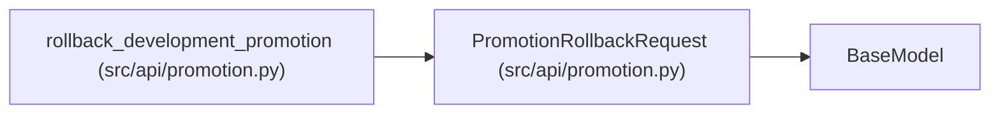

# PromotionRollbackRequest

**Location:** `src/api/promotion.py:110`
**Kind:** Pydantic model
**Bases:** `BaseModel`
**Module:** [promotion](../modules/promotion.md)

## Description

_Auto-generated from `PromotionRollbackRequest` in `src/api/promotion.py`._

## Model Configuration

| Setting | Value | Source |
|---------|-------|--------|
| `extra` | `'forbid'` | model_config |

## Attributes

| Name | Type | Wire name | Required | Nullable | Default | Constraints | Examples | Description |
|------|------|-----------|----------|----------|---------|-------------|-------------|----------|
| `reason` | `str \| None` | `reason` | No | Yes | `None` | — | — | — |
| `reconcile_legacy` | `bool` | `reconcile_legacy` | No | No | `False` | — | — | — |

## Methods

*No public methods. Inherits from base classes.*

## Relationships

<!-- Auto-generated relationship summary. Do not edit by hand. -->

### Summary

| Module | Methods | Attributes |
|---|---:|---|
| [promotion](../modules/promotion.md) | 0 | `reason`, `reconcile_legacy` |

### Structure

| Kind | Entity | Module |
|---|---|---|
| Base | `BaseModel` | — |

### References

| Reference | Kind | Source | Call sites |
|---|---|---|---:|
| `rollback_development_promotion` | call | [promotion](../modules/promotion.md) | 1 |
| `rollback_development_promotion` | type_reference | [promotion](../modules/promotion.md) | — |
