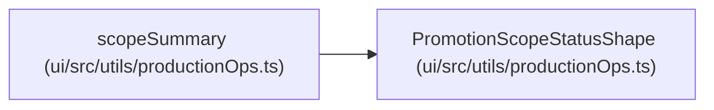

# PromotionScopeStatusShape

**Location:** `ui/src/utils/productionOps.ts:15`
**Kind:** Class
**Bases:** —
**Module:** [productionOps](../modules/productionOps.md)

## Description

_Auto-generated from `PromotionScopeStatusShape` in `ui/src/utils/productionOps.ts`._

## Attributes

| Name | Type | Required | Default | Description |
|------|------|----------|---------|-------------|
| `scope` | `PromotionScopeName` | Yes | — | — |
| `status` | `string` | Yes | — | — |
| `ready` | `boolean` | Yes | — | — |
| `requires_approval` | `boolean` | Yes | — | — |
| `required_prior_scopes` | `PromotionScopeName[]` | Yes | — | — |
| `blockers` | `string[]` | Yes | — | — |
| `blocker_details` | `BlockerDetailShape[]` | Yes | — | — |

## Methods

*No public methods. Inherits from base classes.*

## Relationships

<!-- Auto-generated relationship summary. Do not edit by hand. -->

### Summary

| Module | Methods | Attributes |
|---|---:|---|
| [productionOps](../modules/productionOps.md) | 0 | `blocker_details`, `blockers`, `ready`, `required_prior_scopes`, `requires_approval`, `scope`, `status` |

### References

| Reference | Kind | Source | Call sites |
|---|---|---|---:|
| `scopeSummary` | type_reference | [productionOps](../modules/productionOps.md) | — |
