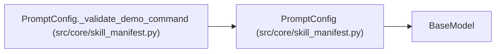

# PromptConfig

**Location:** `src/core/skill_manifest.py:986`
**Kind:** Pydantic model
**Bases:** `BaseModel`
**Module:** [skill_manifest](../modules/skill_manifest.md)

## Description

Prompt-assembly templates (ARC-011 §9 ``prompt``).

## Model Configuration

| Setting | Value | Source |
|---------|-------|--------|
| `extra` | `'forbid'` | model_config |

## Validators

| Method | Scope | Fields | Mode | Options |
|--------|-------|--------|------|---------|
| `_validate_demo_command` | model | — | after | — |

## Attributes

| Name | Type | Wire name | Required | Nullable | Default | Constraints | Examples | Description |
|------|------|-----------|----------|----------|---------|-------------|-------------|----------|
| `setup_command` | `Optional[str]` | `setup_command` | No | Yes | `None` | — | — | — |
| `experiment_command` | `Optional[str]` | `experiment_command` | No | Yes | `None` | — | — | — |
| `continuation_enabled` | `bool` | `continuation_enabled` | No | No | `True` | — | — | — |
| `anti_waste_rules` | `Optional[str]` | `anti_waste_rules` | No | Yes | `None` | — | — | — |
| `demo_experiment_command` | `Optional[str]` | `demo_experiment_command` | No | Yes | `None` | — | — | — |

## Methods

| Method | Signature | Decorators | Description |
|--------|-----------|------------|-------------|
| `_validate_demo_command` | `() -> 'PromptConfig'` | `@model_validator(mode='after')` | — |

## Relationships

<!-- Auto-generated relationship summary. Do not edit by hand. -->

### Summary

| Module | Methods | Attributes |
|---|---:|---|
| [skill_manifest](../modules/skill_manifest.md) | 1 | `anti_waste_rules`, `continuation_enabled`, `demo_experiment_command`, `experiment_command`, `setup_command` |

### Structure

| Kind | Entity | Module |
|---|---|---|
| Base | `BaseModel` | — |

### References

| Reference | Kind | Source | Call sites |
|---|---|---|---:|
| `PromptConfig._validate_demo_command` | type_reference | [skill_manifest](../modules/skill_manifest.md) | — |
