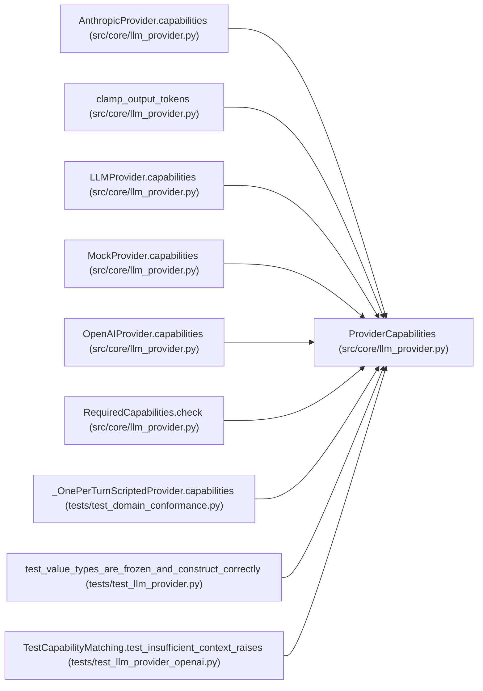

# ProviderCapabilities

**Location:** `src/core/llm_provider.py:261`
**Kind:** Class
**Bases:** —
**Module:** [llm_provider](../modules/llm_provider.md)

**Decorators:** `@dataclass(frozen=True)`

## Description

Static capability advertisement (→ P4-009 capabilities / P4-010 router).

In v1 all targeted providers set ``native_tool_use=True`` and
``system_prompt=True``; the flags are forward-looking (e.g. a local model
without native tool use would need a prompt-based tool-use shim).
``max_output_tokens`` is the adapter's per-request output ceiling;
``None`` means the adapter imposes no ceiling of its own.

## Attributes

| Name | Type | Default | Description |
|------|------|---------|-------------|
| `native_tool_use` | `bool` | *required* | — |
| `streaming` | `bool` | *required* | — |
| `system_prompt` | `bool` | *required* | — |
| `max_context_tokens` | `int` | *required* | — |
| `max_output_tokens` | `Optional[int]` | `None` | — |

## Methods

*No public methods. Inherits from base classes.*

## Relationships

<!-- Auto-generated relationship summary. Do not edit by hand. -->

### Summary

| Module | Methods | Attributes |
|---|---:|---|
| [llm_provider](../modules/llm_provider.md) | 0 | `max_context_tokens`, `max_output_tokens`, `native_tool_use`, `streaming`, `system_prompt` |

### References

| Reference | Kind | Source | Call sites |
|---|---|---|---:|
| `AnthropicProvider.capabilities` | call | [llm_provider](../modules/llm_provider.md) | 1 |
| `AnthropicProvider.capabilities` | type_reference | [llm_provider](../modules/llm_provider.md) | — |
| `clamp_output_tokens` | type_reference | [llm_provider](../modules/llm_provider.md) | — |
| `LLMProvider.capabilities` | type_reference | [llm_provider](../modules/llm_provider.md) | — |
| `MockProvider.capabilities` | call | [llm_provider](../modules/llm_provider.md) | 1 |
| `MockProvider.capabilities` | type_reference | [llm_provider](../modules/llm_provider.md) | — |
| `OpenAIProvider.capabilities` | call | [llm_provider](../modules/llm_provider.md) | 1 |
| `OpenAIProvider.capabilities` | type_reference | [llm_provider](../modules/llm_provider.md) | — |
| `RequiredCapabilities.check` | type_reference | [llm_provider](../modules/llm_provider.md) | — |
| `_OnePerTurnScriptedProvider.capabilities` | call | [test_domain_conformance](../modules/test_domain_conformance.md) | 1 |
| `test_value_types_are_frozen_and_construct_correctly` | type_reference | [test_llm_provider](../modules/test_llm_provider.md) | — |
| `TestCapabilityMatching.test_insufficient_context_raises` | call | [test_llm_provider_openai](../modules/test_llm_provider_openai.md) | 1 |

> References: showing 12 of 19 logical references; 7 omitted by the 12-row generated summary limit.
