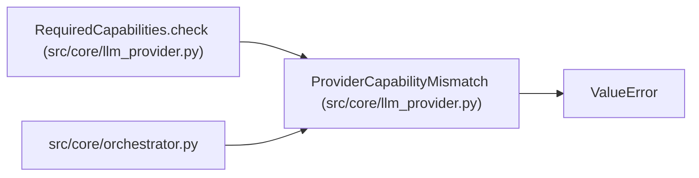

# ProviderCapabilityMismatch

**Location:** `src/core/llm_provider.py:1058`
**Kind:** Class
**Bases:** `ValueError`
**Module:** [llm_provider](../modules/llm_provider.md)

## Description

Raised (ARC-011 P4-009) when a skill manifest's required capabilities
are not satisfied by the selected provider's ``capabilities()``.

Fail-closed: a session whose skill demands (e.g.) native tool use but is
routed to a provider that lacks it must be rejected at session start,
before any LLM call — mirroring the codebase's existing fail-closed posture
(production-approval HMAC, command policy default-deny).

## Attributes

*No annotated attributes found.*

## Methods

*No public methods. Inherits from base classes.*

## Relationships

<!-- Auto-generated relationship summary. Do not edit by hand. -->

### Summary

| Module | Methods | Attributes |
|---|---:|---|
| [llm_provider](../modules/llm_provider.md) | 0 | — |

### Structure

| Kind | Entity | Module |
|---|---|---|
| Base | `ValueError` | — |

### References

| Reference | Kind | Source | Call sites |
|---|---|---|---:|
| `RequiredCapabilities.check` | call | [llm_provider](../modules/llm_provider.md) | 1 |
| `orchestrator` | import | [orchestrator](../modules/orchestrator.md) | — |
