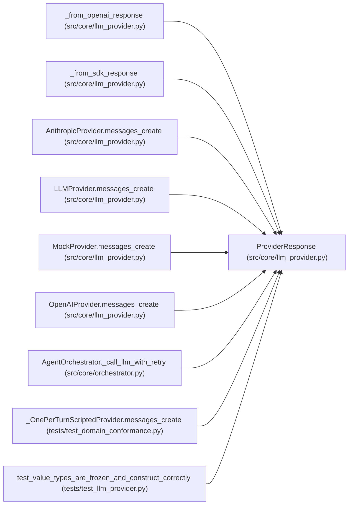

# ProviderResponse

**Location:** `src/core/llm_provider.py:246`
**Kind:** Class
**Bases:** —
**Module:** [llm_provider](../modules/llm_provider.md)

**Decorators:** `@dataclass(frozen=True)`

## Description

Normalized response from ``messages_create``.

``stop_reason`` is the R5-critical normalized field. ``raw_model`` is the
concrete model id actually used (for cost accounting / audit), which may
differ from the requested alias.

## Attributes

| Name | Type | Default | Description |
|------|------|---------|-------------|
| `content` | `list[ContentBlock]` | *required* | — |
| `stop_reason` | `StopReason` | *required* | — |
| `usage` | `Usage` | *required* | — |
| `raw_model` | `str` | *required* | — |

## Methods

*No public methods. Inherits from base classes.*

## Relationships

<!-- Auto-generated relationship summary. Do not edit by hand. -->

### Summary

| Module | Methods | Attributes |
|---|---:|---|
| [llm_provider](../modules/llm_provider.md) | 0 | `content`, `raw_model`, `stop_reason`, `usage` |

### References

| Reference | Kind | Source | Call sites |
|---|---|---|---:|
| `_from_openai_response` | call | [llm_provider](../modules/llm_provider.md) | 1 |
| `_from_openai_response` | type_reference | [llm_provider](../modules/llm_provider.md) | — |
| `_from_sdk_response` | call | [llm_provider](../modules/llm_provider.md) | 1 |
| `_from_sdk_response` | type_reference | [llm_provider](../modules/llm_provider.md) | — |
| `AnthropicProvider.messages_create` | type_reference | [llm_provider](../modules/llm_provider.md) | — |
| `LLMProvider.messages_create` | type_reference | [llm_provider](../modules/llm_provider.md) | — |
| `MockProvider.messages_create` | call | [llm_provider](../modules/llm_provider.md) | 3 |
| `MockProvider.messages_create` | type_reference | [llm_provider](../modules/llm_provider.md) | — |
| `OpenAIProvider.messages_create` | type_reference | [llm_provider](../modules/llm_provider.md) | — |
| `AgentOrchestrator._call_llm_with_retry` | type_reference | [orchestrator](../modules/orchestrator.md) | — |
| `_OnePerTurnScriptedProvider.messages_create` | call | [test_domain_conformance](../modules/test_domain_conformance.md) | 2 |
| `test_value_types_are_frozen_and_construct_correctly` | type_reference | [test_llm_provider](../modules/test_llm_provider.md) | — |

> References: showing 12 of 17 logical references; 5 omitted by the 12-row generated summary limit.
