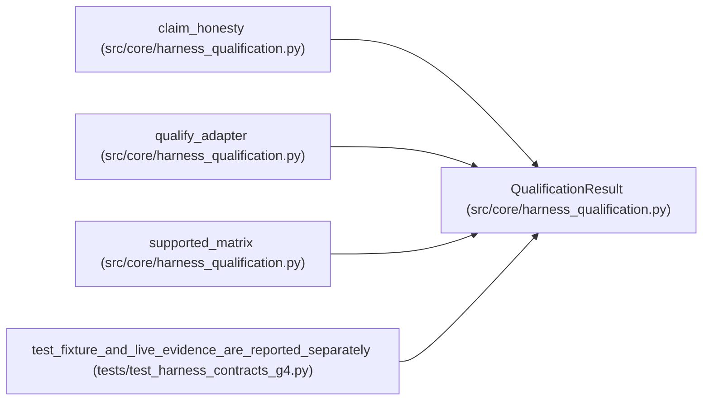

# QualificationResult

**Location:** `src/core/harness_qualification.py:26`
**Kind:** Class
**Bases:** —
**Module:** [harness_qualification](../modules/harness_qualification.md)

**Decorators:** `@dataclass`

## Description

One adapter's qualification: semantics, negatives, and honesty.

## Attributes

| Name | Type | Default | Description |
|------|------|---------|-------------|
| `adapter` | `str` | *required* | — |
| `version` | `str` | *required* | — |
| `interface` | `str` | *required* | — |
| `contract_version` | `str` | *required* | — |
| `capabilities` | `tuple[str, ...]` | *required* | — |
| `required_semantics` | `bool` | *required* | — |
| `negative_cases` | `dict[str, bool]` | `field(default_factory=dict)` | — |
| `fixture_evidence` | `str` | `'none'` | — |
| `live_evidence` | `str` | `'not_run'` | — |
| `compatibility_claim` | `bool` | `False` | — |
| `notes` | `tuple[str, ...]` | `()` | — |

## Methods

| Method | Signature | Decorators | Description |
|--------|-----------|------------|-------------|
| `as_dict` | `() -> dict[str, Any]` | — | — |

## Relationships

<!-- Auto-generated relationship summary. Do not edit by hand. -->

### Summary

| Module | Methods | Attributes |
|---|---:|---|
| [harness_qualification](../modules/harness_qualification.md) | 1 | `adapter`, `capabilities`, `compatibility_claim`, `contract_version`, `fixture_evidence`, `interface`, `live_evidence`, `negative_cases`, `notes`, `required_semantics`, `version` |

### References

| Reference | Kind | Source | Call sites |
|---|---|---|---:|
| `claim_honesty` | type_reference | [harness_qualification](../modules/harness_qualification.md) | — |
| `qualify_adapter` | call | [harness_qualification](../modules/harness_qualification.md) | 1 |
| `qualify_adapter` | type_reference | [harness_qualification](../modules/harness_qualification.md) | — |
| `supported_matrix` | type_reference | [harness_qualification](../modules/harness_qualification.md) | — |
| `test_fixture_and_live_evidence_are_reported_separately` | call | [test_harness_contracts_g4](../modules/test_harness_contracts_g4.md) | 1 |
