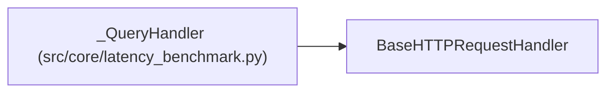

# _QueryHandler

**Location:** `src/core/latency_benchmark.py:105`
**Kind:** Class
**Bases:** `BaseHTTPRequestHandler`
**Module:** [latency_benchmark](../modules/latency_benchmark.md)

## Description

_Auto-generated from `_QueryHandler` in `src/core/latency_benchmark.py`._

## Attributes

| Name | Type | Default | Description |
|------|------|---------|-------------|
| `variant` | `Callable[[tuple[tuple[str, float], ...], str], float]` | *required* | — |
| `items` | `tuple[tuple[str, float], ...]` | `()` | — |

## Methods

| Method | Signature | Decorators | Description |
|--------|-----------|------------|-------------|
| `do_GET` | `() -> None` | — | — |
| `log_message` | `(*args: Any) -> None` | — | — |

## Relationships

<!-- Auto-generated relationship summary. Do not edit by hand. -->

### Summary

| Module | Methods | Attributes |
|---|---:|---|
| [latency_benchmark](../modules/latency_benchmark.md) | 2 | `items`, `variant` |

### Structure

| Kind | Entity | Module |
|---|---|---|
| Base | `BaseHTTPRequestHandler` | — |
