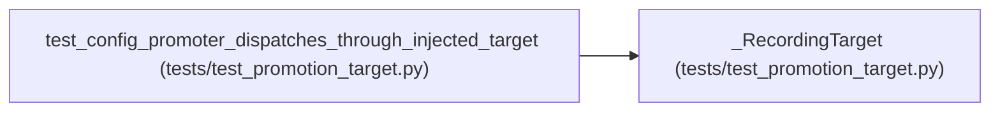

# _RecordingTarget

**Location:** `tests/test_promotion_target.py:147`
**Kind:** Class
**Bases:** —
**Module:** [test_promotion_target](../modules/test_promotion_target.md)

## Description

Records every dispatch; returns fixed values (ARC-011 review C2-5).

Proves the injected target is actually dispatched through, not just
stored — the guarantee the P1-017 CHANGELOG entry claimed but no test
previously pinned (finding H6 in the 2026-08-15 review).

## Attributes

*No annotated attributes found.*

## Methods

| Method | Signature | Decorators | Description |
|--------|-----------|------------|-------------|
| `__init__` | `() -> None` | — | — |
| `target_path` | `(**kwargs: object) -> str` | — | — |
| `metadata_sidecar_path` | `(target_path: str, iteration: int, **kw: object) -> str` | — | — |
| `rollback_snapshot_path` | `(**kwargs: object) -> str` | — | — |
| `rollback_metadata_sidecar_path` | `(target_path: str, promotion_id: int) -> str` | — | — |
| `write` | *(async)* `(path: str, content: str) -> None` | — | — |

## Relationships

<!-- Auto-generated relationship summary. Do not edit by hand. -->

### Summary

| Module | Methods | Attributes |
|---|---:|---|
| [test_promotion_target](../modules/test_promotion_target.md) | 6 | — |

### References

| Reference | Kind | Source | Call sites |
|---|---|---|---:|
| `test_config_promoter_dispatches_through_injected_target` | call | [test_promotion_target](../modules/test_promotion_target.md) | 1 |
