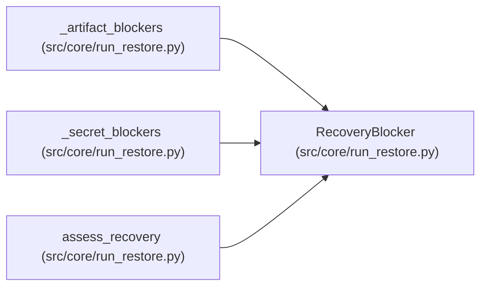

# RecoveryBlocker

**Location:** `src/core/run_restore.py:44`
**Kind:** Class
**Bases:** —
**Module:** [run_restore](../modules/run_restore.md)

**Decorators:** `@dataclass(frozen=True)`

## Description

One reason a restore cannot satisfy the pinned contract.

## Attributes

| Name | Type | Default | Description |
|------|------|---------|-------------|
| `code` | `str` | *required* | — |
| `detail` | `str` | *required* | — |
| `remediation` | `str` | *required* | — |

## Methods

| Method | Signature | Decorators | Description |
|--------|-----------|------------|-------------|
| `as_dict` | `() -> Dict[str, str]` | — | — |

## Relationships

<!-- Auto-generated relationship summary. Do not edit by hand. -->

### Summary

| Module | Methods | Attributes |
|---|---:|---|
| [run_restore](../modules/run_restore.md) | 1 | `code`, `detail`, `remediation` |

### References

| Reference | Kind | Source | Call sites |
|---|---|---|---:|
| `_artifact_blockers` | call | [run_restore](../modules/run_restore.md) | 1 |
| `_artifact_blockers` | type_reference | [run_restore](../modules/run_restore.md) | — |
| `_secret_blockers` | call | [run_restore](../modules/run_restore.md) | 1 |
| `_secret_blockers` | type_reference | [run_restore](../modules/run_restore.md) | — |
| `assess_recovery` | call | [run_restore](../modules/run_restore.md) | 3 |
