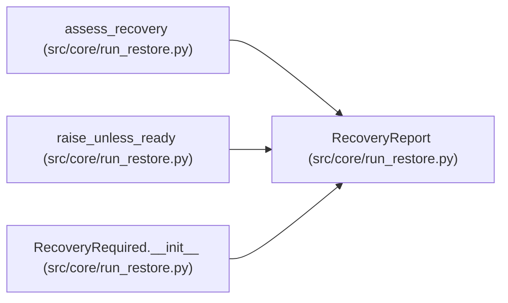

# RecoveryReport

**Location:** `src/core/run_restore.py:56`
**Kind:** Class
**Bases:** —
**Module:** [run_restore](../modules/run_restore.md)

**Decorators:** `@dataclass`

## Description

The assessment outcome for one restore request.

## Attributes

| Name | Type | Default | Description |
|------|------|---------|-------------|
| `kind` | `str` | *required* | — |
| `session_id` | `str` | *required* | — |
| `ready` | `bool` | *required* | — |
| `contract` | `Dict[str, Any]` | `field(default_factory=dict)` | — |
| `lineage` | `Dict[str, Any]` | `field(default_factory=dict)` | — |
| `blockers` | `List[RecoveryBlocker]` | `field(default_factory=list)` | — |
| `notes` | `List[str]` | `field(default_factory=list)` | — |

## Methods

| Method | Signature | Decorators | Description |
|--------|-----------|------------|-------------|
| `as_dict` | `() -> Dict[str, Any]` | — | — |

## Relationships

<!-- Auto-generated relationship summary. Do not edit by hand. -->

### Summary

| Module | Methods | Attributes |
|---|---:|---|
| [run_restore](../modules/run_restore.md) | 1 | `blockers`, `contract`, `kind`, `lineage`, `notes`, `ready`, `session_id` |

### References

| Reference | Kind | Source | Call sites |
|---|---|---|---:|
| `assess_recovery` | call | [run_restore](../modules/run_restore.md) | 1 |
| `assess_recovery` | type_reference | [run_restore](../modules/run_restore.md) | — |
| `raise_unless_ready` | type_reference | [run_restore](../modules/run_restore.md) | — |
| `RecoveryRequired.__init__` | type_reference | [run_restore](../modules/run_restore.md) | — |
