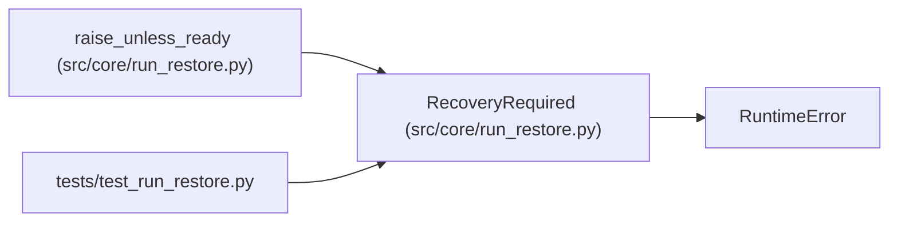

# RecoveryRequired

**Location:** `src/core/run_restore.py:79`
**Kind:** Class
**Bases:** `RuntimeError`
**Module:** [run_restore](../modules/run_restore.md)

## Description

A restore is blocked and needs explicit operator action.

The message names every blocker with its remediation; ``report`` carries
the structured assessment. This is an actionable recovery state, never a
silent fresh run.

## Attributes

*No annotated attributes found.*

## Methods

| Method | Signature | Decorators | Description |
|--------|-----------|------------|-------------|
| `__init__` | `(report: RecoveryReport) -> None` | — | — |

## Relationships

<!-- Auto-generated relationship summary. Do not edit by hand. -->

### Summary

| Module | Methods | Attributes |
|---|---:|---|
| [run_restore](../modules/run_restore.md) | 1 | — |

### Structure

| Kind | Entity | Module |
|---|---|---|
| Base | `RuntimeError` | — |

### References

| Reference | Kind | Source | Call sites |
|---|---|---|---:|
| `raise_unless_ready` | call | [run_restore](../modules/run_restore.md) | 1 |
| `test_run_restore` | import | [test_run_restore](../modules/test_run_restore.md) | — |
