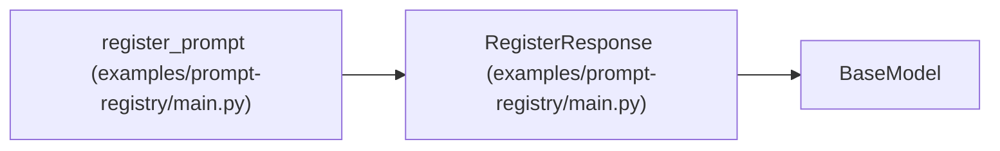

# RegisterResponse

**Location:** `examples/prompt-registry/main.py:50`
**Kind:** Pydantic model
**Bases:** `BaseModel`
**Module:** [examples_prompt-registry_main](../modules/examples_prompt-registry_main.md)

## Description

_Auto-generated from `RegisterResponse` in `examples/prompt-registry/main.py`._

## Attributes

| Name | Type | Wire name | Required | Nullable | Default | Constraints | Examples | Description |
|------|------|-----------|----------|----------|---------|-------------|-------------|----------|
| `prompt_id` | `str` | `prompt_id` | Yes | No | — | — | — | — |
| `status` | `str` | `status` | Yes | No | — | — | — | — |
| `idempotent_replay` | `bool` | `idempotent_replay` | No | No | `False` | — | — | — |

## Methods

*No public methods. Inherits from base classes.*

## Relationships

<!-- Auto-generated relationship summary. Do not edit by hand. -->

### Summary

| Module | Methods | Attributes |
|---|---:|---|
| [examples_prompt-registry_main](../modules/examples_prompt-registry_main.md) | 0 | `idempotent_replay`, `prompt_id`, `status` |

### Structure

| Kind | Entity | Module |
|---|---|---|
| Base | `BaseModel` | — |

### References

| Reference | Kind | Source | Call sites |
|---|---|---|---:|
| `register_prompt` | call | [examples_prompt-registry_main](../modules/examples_prompt-registry_main.md) | 2 |
| `register_prompt` | type_reference | [examples_prompt-registry_main](../modules/examples_prompt-registry_main.md) | — |
