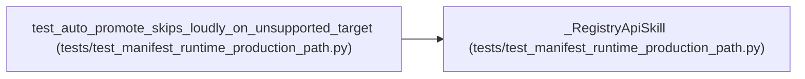

# _RegistryApiSkill

**Location:** `tests/test_manifest_runtime_production_path.py:459`
**Kind:** Class
**Bases:** —
**Module:** [test_manifest_runtime_production_path](../modules/test_manifest_runtime_production_path.md)

## Description

_Auto-generated from `_RegistryApiSkill` in `tests/test_manifest_runtime_production_path.py`._

## Attributes

*No annotated attributes found.*

## Methods

| Method | Signature | Decorators | Description |
|--------|-----------|------------|-------------|
| `promotion_target` | `()` | — | — |

## Relationships

<!-- Auto-generated relationship summary. Do not edit by hand. -->

### Summary

| Module | Methods | Attributes |
|---|---:|---|
| [test_manifest_runtime_production_path](../modules/test_manifest_runtime_production_path.md) | 1 | — |

### References

| Reference | Kind | Source | Call sites |
|---|---|---|---:|
| `test_auto_promote_skips_loudly_on_unsupported_target` | call | [test_manifest_runtime_production_path](../modules/test_manifest_runtime_production_path.md) | 1 |
