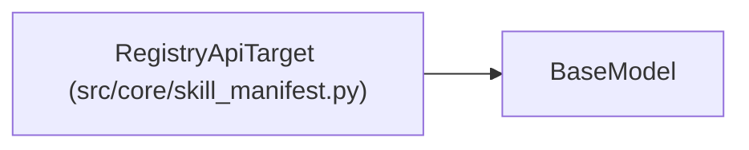

# RegistryApiTarget

**Location:** `src/core/skill_manifest.py:678`
**Kind:** Pydantic model
**Bases:** `BaseModel`
**Module:** [skill_manifest](../modules/skill_manifest.md)

## Description

``kind: registry_api`` — production composite REST promotion (G5).
Enriched beyond the thin Analysis-§9 descriptor: lookup query, Bearer auth
secret name, the rollup metric forwarded. The REST client itself stays in
``ConfigPromoter`` for Phase 2; the manifest *describes* it. The G5
enrichment fields are optional so both the ml-direction production
``delegate`` (full G5 form) and the simpler prompt-registry primary validate.

## Model Configuration

| Setting | Value | Source |
|---------|-------|--------|
| `extra` | `'forbid'` | model_config |

## Attributes

| Name | Type | Wire name | Required | Nullable | Default | Constraints | Examples | Description |
|------|------|-----------|----------|----------|---------|-------------|-------------|----------|
| `kind` | `Literal['registry_api']` | `kind` | No | No | `'registry_api'` | — | — | — |
| `registry` | `str` | `registry` | Yes | No | — | — | — | — |
| `endpoint` | `Optional[str]` | `register_endpoint` | No | Yes | `None` | — | — | — |
| `lookup` | `Optional[RegistryLookup]` | `lookup` | No | Yes | `None` | — | — | — |
| `auth_secret` | `Optional[str]` | `auth_secret` | No | Yes | `None` | — | — | — |
| `rollup_metric` | `Optional[str]` | `rollup_metric` | No | Yes | `None` | — | — | — |
| `atomic_write` | `bool` | `atomic_write` | No | No | `True` | — | — | — |

## Methods

*No public methods. Inherits from base classes.*

## Relationships

<!-- Auto-generated relationship summary. Do not edit by hand. -->

### Summary

| Module | Methods | Attributes |
|---|---:|---|
| [skill_manifest](../modules/skill_manifest.md) | 0 | `atomic_write`, `auth_secret`, `endpoint`, `kind`, `lookup`, `registry`, `rollup_metric` |

### Structure

| Kind | Entity | Module |
|---|---|---|
| Base | `BaseModel` | — |
