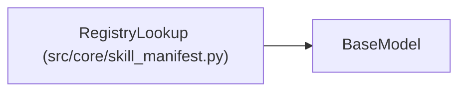

# RegistryLookup

**Location:** `src/core/skill_manifest.py:663`
**Kind:** Pydantic model
**Bases:** `BaseModel`
**Module:** [skill_manifest](../modules/skill_manifest.md)

## Description

``registry_api.lookup`` — how to find the composite to promote (G5).

## Model Configuration

| Setting | Value | Source |
|---------|-------|--------|
| `extra` | `'forbid'` | model_config |

## Attributes

| Name | Type | Wire name | Required | Nullable | Default | Constraints | Examples | Description |
|------|------|-----------|----------|----------|---------|-------------|-------------|----------|
| `by` | `str` | `by` | Yes | No | — | — | — | Composite version field to match (e.g. ``serving_model_version``). |
| `query_endpoint` | `str` | `query_endpoint` | Yes | No | — | — | — | — |

## Methods

*No public methods. Inherits from base classes.*

## Relationships

<!-- Auto-generated relationship summary. Do not edit by hand. -->

### Summary

| Module | Methods | Attributes |
|---|---:|---|
| [skill_manifest](../modules/skill_manifest.md) | 0 | `by`, `query_endpoint` |

### Structure

| Kind | Entity | Module |
|---|---|---|
| Base | `BaseModel` | — |
