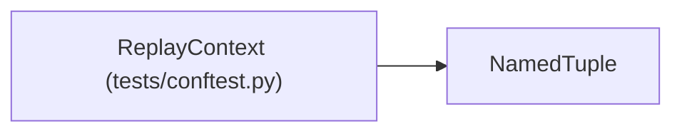

# ReplayContext

**Location:** `tests/conftest.py:88`
**Kind:** Class
**Bases:** `NamedTuple`
**Module:** [tests_conftest](../modules/tests_conftest.md)

## Description

Result of seeding a ResultsStore from a JSON fixture file.

Attributes:
    store:       Initialized ResultsStore backed by a tmp_path SQLite file.
    session_id:  The research session ID used for all seeded rows.
    session:     The full session dict as returned by store.get_session().
    iterations:  Full DB row dicts (all columns) for all seeded iterations,
                 ordered by iteration number.  Equivalent to
                 store.get_iterations(session_id).
    raw:         The raw parsed JSON fixture dict, for accessing extra fields
                 like ``config_snapshot_as_dict`` on individual iterations.

## Attributes

| Name | Type | Default | Description |
|------|------|---------|-------------|
| `store` | `ResultsStore` | *required* | — |
| `session_id` | `str` | *required* | — |
| `session` | `Dict[str, Any]` | *required* | — |
| `iterations` | `List[Dict[str, Any]]` | *required* | — |
| `raw` | `Dict[str, Any]` | *required* | — |

## Methods

*No public methods. Inherits from base classes.*

## Relationships

<!-- Auto-generated relationship summary. Do not edit by hand. -->

### Summary

| Module | Methods | Attributes |
|---|---:|---|
| [tests_conftest](../modules/tests_conftest.md) | 0 | `iterations`, `raw`, `session`, `session_id`, `store` |

### Structure

| Kind | Entity | Module |
|---|---|---|
| Base | `NamedTuple` | — |
