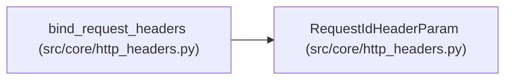

# RequestIdHeaderParam

**Location:** `src/core/http_headers.py:21`
**Kind:** Type alias
**Bases:** —
**Module:** [http_headers](../modules/http_headers.md)
**Target:** `Annotated[str \| None, Header(alias=REQUEST_ID_HEADER, description='Correlation identifier; auto-generated UUID4 when missing.')]`

## Description

_Auto-generated from `RequestIdHeaderParam` in `src/core/http_headers.py`._

## Attributes

*No annotated attributes found.*

## Methods

*No public methods. Inherits from base classes.*

## Relationships

<!-- Auto-generated relationship summary. Do not edit by hand. -->

### Summary

| Module | Methods | Attributes |
|---|---:|---|
| [http_headers](../modules/http_headers.md) | 0 | — |

### References

| Reference | Kind | Source | Call sites |
|---|---|---|---:|
| `bind_request_headers` | type_reference | [http_headers](../modules/http_headers.md) | — |
