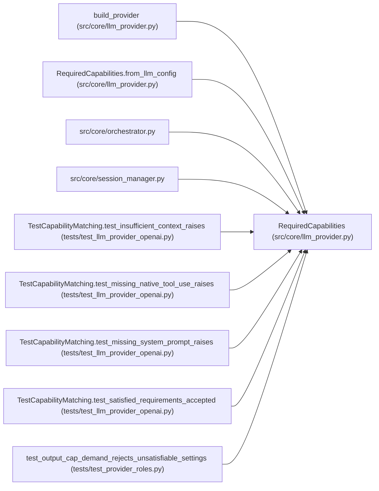

# RequiredCapabilities

**Location:** `src/core/llm_provider.py:1229`
**Kind:** Class
**Bases:** —
**Module:** [llm_provider](../modules/llm_provider.md)

## Description

Subset of :class:`ProviderCapabilities` a skill demands (P4-009).

## Attributes

*No annotated attributes found.*

## Methods

| Method | Signature | Decorators | Description |
|--------|-----------|------------|-------------|
| `__init__` | `(*, native_tool_use: Optional[bool] = None, system_prompt: Optional[bool] = None, max_context_tokens: Optional[int] = None, max_output_tokens: Optional[int] = None) -> None` | — | — |
| `from_llm_config` | `(llm_cfg: Any) -> 'RequiredCapabilities'` | `@classmethod` | Build from a skill manifest's ``LLMConfig`` (P4-009). |
| `check` | `(caps: ProviderCapabilities, provider_id: str) -> None` | — | Raise :class:`ProviderCapabilityMismatch` if ``caps`` is insufficient. |

## Relationships

<!-- Auto-generated relationship summary. Do not edit by hand. -->

### Summary

| Module | Methods | Attributes |
|---|---:|---|
| [llm_provider](../modules/llm_provider.md) | 3 | — |

### References

| Reference | Kind | Source | Call sites |
|---|---|---|---:|
| `build_provider` | type_reference | [llm_provider](../modules/llm_provider.md) | — |
| `RequiredCapabilities.from_llm_config` | call | [llm_provider](../modules/llm_provider.md) | 1 |
| `RequiredCapabilities.from_llm_config` | type_reference | [llm_provider](../modules/llm_provider.md) | — |
| `orchestrator` | import | [orchestrator](../modules/orchestrator.md) | — |
| `session_manager` | import | [session_manager](../modules/session_manager.md) | — |
| `TestCapabilityMatching.test_insufficient_context_raises` | call | [test_llm_provider_openai](../modules/test_llm_provider_openai.md) | 1 |
| `TestCapabilityMatching.test_missing_native_tool_use_raises` | call | [test_llm_provider_openai](../modules/test_llm_provider_openai.md) | 1 |
| `TestCapabilityMatching.test_missing_system_prompt_raises` | call | [test_llm_provider_openai](../modules/test_llm_provider_openai.md) | 1 |
| `TestCapabilityMatching.test_satisfied_requirements_accepted` | call | [test_llm_provider_openai](../modules/test_llm_provider_openai.md) | 1 |
| `test_output_cap_demand_rejects_unsatisfiable_settings` | call | [test_provider_roles](../modules/test_provider_roles.md) | 2 |
