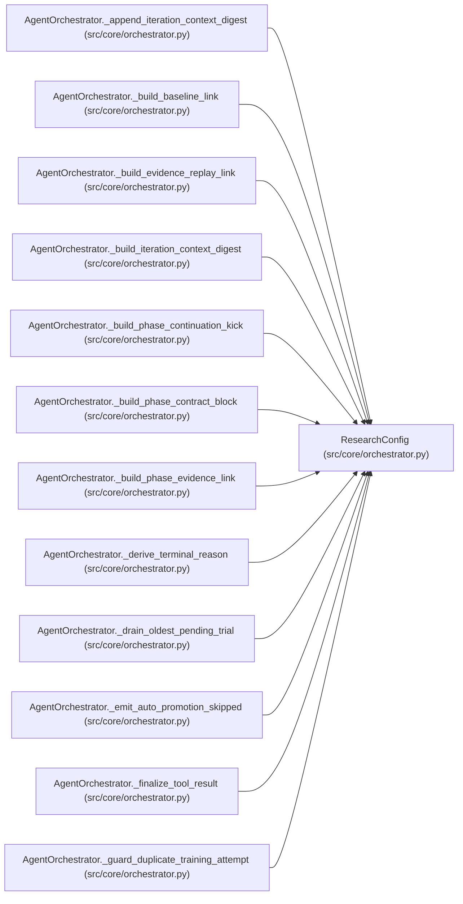

# ResearchConfig

**Location:** `src/core/orchestrator.py:189`
**Kind:** Class
**Bases:** —
**Module:** [orchestrator](../modules/orchestrator.md)

**Decorators:** `@dataclass`

## Description

_Auto-generated from `ResearchConfig` in `src/core/orchestrator.py`._

## Attributes

| Name | Type | Default | Description |
|------|------|---------|-------------|
| `id` | `str` | *required* | — |
| `instrument` | `str` | *required* | — |
| `timeframe` | `str` | *required* | — |
| `model_type` | `str` | *required* | — |
| `tag` | `str` | `''` | — |
| `quick_mode` | `bool` | `False` | — |
| `max_iterations` | `int` | `30` | — |
| `max_budget_usd` | `float` | `10.0` | — |
| `timeout_s` | `int` | `0` | — |
| `focus_hint` | `Optional[str]` | `None` | — |
| `workspace_path` | `str` | `''` | — |
| `resumed_from` | `Optional[str]` | `None` | — |
| `pipeline_id` | `Optional[str]` | `None` | — |
| `skill_id` | `str` | `''` | — |
| `skill_version` | `str` | `''` | — |
| `subject_id` | `str` | `''` | — |
| `variant` | `str` | `''` | — |
| `skill_params` | `dict` | `None` | — |
| `session_nonce` | `str` | `''` | — |

## Methods

| Method | Signature | Decorators | Description |
|--------|-----------|------------|-------------|
| `__post_init__` | `() -> None` | — | — |
| `domain` | `() -> str` | `@property` | The research domain (legacy ``model_type`` value: direction/volatility/rl). |

## Relationships

<!-- Auto-generated relationship summary. Do not edit by hand. -->

### Summary

| Module | Methods | Attributes |
|---|---:|---|
| [orchestrator](../modules/orchestrator.md) | 2 | `focus_hint`, `id`, `instrument`, `max_budget_usd`, `max_iterations`, `model_type`, `pipeline_id`, `quick_mode`, `resumed_from`, `session_nonce`, `skill_id`, `skill_params` |

### References

| Reference | Kind | Source | Call sites |
|---|---|---|---:|
| `AgentOrchestrator._append_iteration_context_digest` | type_reference | [orchestrator](../modules/orchestrator.md) | — |
| `AgentOrchestrator._build_baseline_link` | type_reference | [orchestrator](../modules/orchestrator.md) | — |
| `AgentOrchestrator._build_evidence_replay_link` | type_reference | [orchestrator](../modules/orchestrator.md) | — |
| `AgentOrchestrator._build_iteration_context_digest` | type_reference | [orchestrator](../modules/orchestrator.md) | — |
| `AgentOrchestrator._build_phase_continuation_kick` | type_reference | [orchestrator](../modules/orchestrator.md) | — |
| `AgentOrchestrator._build_phase_contract_block` | type_reference | [orchestrator](../modules/orchestrator.md) | — |
| `AgentOrchestrator._build_phase_evidence_link` | type_reference | [orchestrator](../modules/orchestrator.md) | — |
| `AgentOrchestrator._derive_terminal_reason` | type_reference | [orchestrator](../modules/orchestrator.md) | — |
| `AgentOrchestrator._drain_oldest_pending_trial` | type_reference | [orchestrator](../modules/orchestrator.md) | — |
| `AgentOrchestrator._emit_auto_promotion_skipped` | type_reference | [orchestrator](../modules/orchestrator.md) | — |
| `AgentOrchestrator._finalize_tool_result` | type_reference | [orchestrator](../modules/orchestrator.md) | — |
| `AgentOrchestrator._guard_duplicate_training_attempt` | type_reference | [orchestrator](../modules/orchestrator.md) | — |

> References: showing 12 of 105 logical references; 93 omitted by the 12-row generated summary limit.
