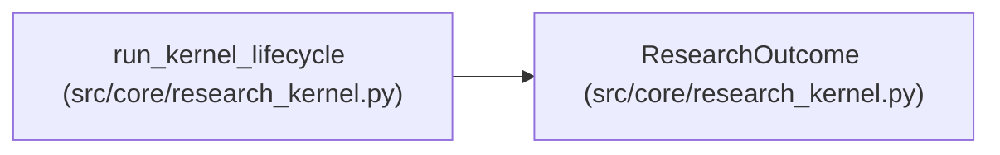

# ResearchOutcome

**Location:** `src/core/research_kernel.py:91`
**Kind:** Class
**Bases:** —
**Module:** [research_kernel](../modules/research_kernel.md)

**Decorators:** `@dataclass(frozen=True)`

## Description

The completed lifecycle: attempts run and the final decisions.

## Attributes

| Name | Type | Default | Description |
|------|------|---------|-------------|
| `completed` | `bool` | *required* | — |
| `attempts` | `tuple[AttemptResult, ...]` | `()` | — |
| `plan` | `Optional[AttemptPlan]` | `None` | — |
| `objective` | `Optional[ObjectiveDecision]` | `None` | — |
| `budget` | `Optional[BudgetDecision]` | `None` | — |
| `promotion` | `Optional[PromotionDecision]` | `None` | — |

## Methods

*No public methods. Inherits from base classes.*

## Relationships

<!-- Auto-generated relationship summary. Do not edit by hand. -->

### Summary

| Module | Methods | Attributes |
|---|---:|---|
| [research_kernel](../modules/research_kernel.md) | 0 | `attempts`, `budget`, `completed`, `objective`, `plan`, `promotion` |

### References

| Reference | Kind | Source | Call sites |
|---|---|---|---:|
| `run_kernel_lifecycle` | call | [research_kernel](../modules/research_kernel.md) | 1 |
| `run_kernel_lifecycle` | type_reference | [research_kernel](../modules/research_kernel.md) | — |
