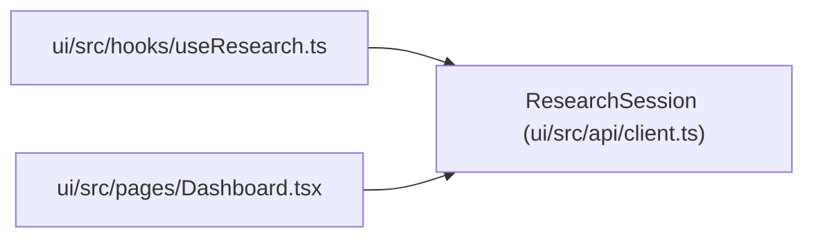

# ResearchSession

**Location:** `ui/src/api/client.ts:4`
**Kind:** Class
**Bases:** —
**Module:** [client](../modules/client.md)

## Description

_Auto-generated from `ResearchSession` in `ui/src/api/client.ts`._

## Attributes

| Name | Type | Required | Default | Description |
|------|------|----------|---------|-------------|
| `id` | `string` | Yes | — | — |
| `instrument` | `string` | Yes | — | — |
| `timeframe` | `string` | Yes | — | — |
| `model_type` | `string` | Yes | — | — |
| `skill_id` | `string` | No | — | — |
| `subject_id` | `string` | No | — | — |
| `variant` | `string` | No | — | — |
| `tag` | `string` | Yes | — | — |
| `skill_name` | `string` | Yes | — | — |
| `status` | `string` | Yes | — | — |
| `quick_mode` | `boolean \| number` | Yes | — | — |
| `max_iterations` | `number` | Yes | — | — |
| `max_budget_usd` | `number` | Yes | — | — |
| `focus_hint` | `string \| null` | Yes | — | — |
| `workspace_path` | `string` | Yes | — | — |
| `best_metric` | `number \| null` | Yes | — | — |
| `best_iteration` | `number \| null` | Yes | — | — |
| `total_api_cost_usd` | `number` | Yes | — | — |
| `started_at` | `string` | Yes | — | — |
| `completed_at` | `string \| null` | Yes | — | — |
| `error_message` | `string \| null` | Yes | — | — |
| `effective_iteration_count` | `number \| null` | No | — | — |
| `resumed_from` | `string \| null` | Yes | — | — |
| `current_phase` | `string \| null` | No | — | — |
| `next_action` | `string \| null` | No | — | — |
| `phase_state_json` | `string \| null` | No | — | — |
| `active_phase_session_id` | `string \| null` | No | — | — |
| `promotion_blocked_phase` | `string \| null` | No | — | — |
| `promotion_blockers` | `string[]` | No | — | — |
| `promotion_preview` | `Record<string, unknown> \| null` | No | — | — |

## Methods

*No public methods. Inherits from base classes.*

## Relationships

<!-- Auto-generated relationship summary. Do not edit by hand. -->

### Summary

| Module | Methods | Attributes |
|---|---:|---|
| [client](../modules/client.md) | 0 | `active_phase_session_id`, `best_iteration`, `best_metric`, `completed_at`, `current_phase`, `effective_iteration_count`, `error_message`, `focus_hint`, `id`, `instrument`, `max_budget_usd`, `max_iterations` |

### References

| Reference | Kind | Source | Call sites |
|---|---|---|---:|
| `useResearch` | import | [useResearch](../modules/useResearch.md) | — |
| `Dashboard` | import | [Dashboard](../modules/Dashboard.md) | — |
