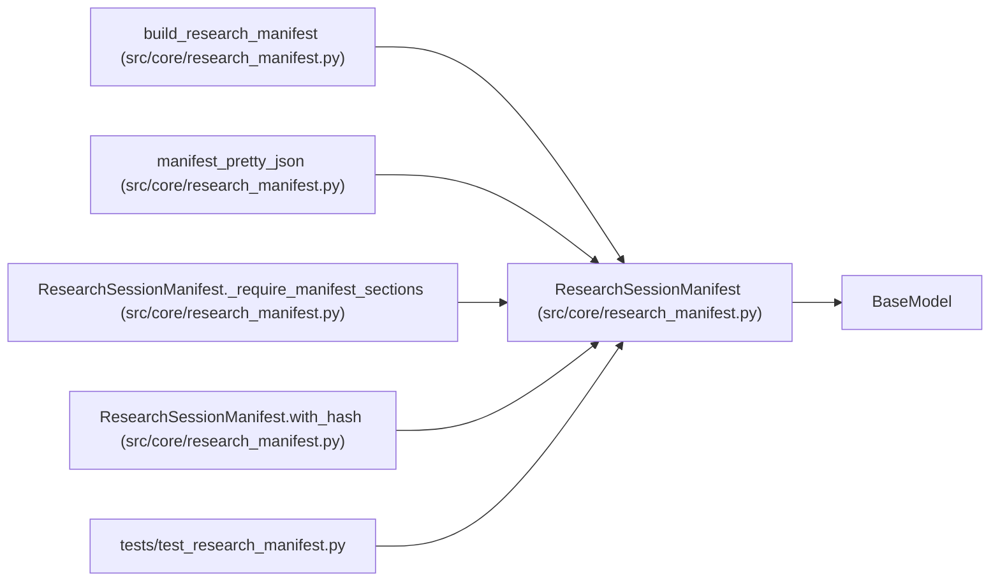

# ResearchSessionManifest

**Location:** `src/core/research_manifest.py:73`
**Kind:** Pydantic model
**Bases:** `BaseModel`
**Module:** [research_manifest](../modules/research_manifest.md)

## Description

Complete immutable manifest for one autonomous research session.

## Model Configuration

| Setting | Value | Source |
|---------|-------|--------|
| `extra` | `'forbid'` | model_config |

## Validators

| Method | Scope | Fields | Mode | Options |
|--------|-------|--------|------|---------|
| `_accept_known_schema_versions` | field | schema_version | before | — |
| `_not_blank` | field | instrument, timeframe, objective, model_family | after | — |
| `_require_manifest_sections` | model | — | after | — |

## Attributes

| Name | Type | Wire name | Required | Nullable | Default | Constraints | Examples | Description |
|------|------|-----------|----------|----------|---------|-------------|-------------|----------|
| `schema_version` | `str` | `schema_version` | No | No | `CURRENT_SCHEMA_VERSION` | — | — | — |
| `research_id` | `str` | `research_id` | Yes | No | — | — | — | — |
| `created_at` | `str` | `created_at` | No | No | factory: `lambda: datetime.now(timezone.utc).isoformat()` | — | — | — |
| `instrument` | `str` | `instrument` | Yes | No | — | — | — | — |
| `timeframe` | `str` | `timeframe` | Yes | No | — | — | — | — |
| `model_type` | `str` | `model_type` | No | No | `''` | pattern='^(direction\|volatility\|rl)$\|^$' | — | — |
| `objective` | `str` | `objective` | Yes | No | — | — | — | — |
| `model_family` | `str` | `model_family` | Yes | No | — | — | — | — |
| `data_window` | `Optional[Dict[str, Any]]` | `data_window` | No | Yes | `None` | — | — | — |
| `baseline_config` | `Optional[Dict[str, Any]]` | `baseline_config` | No | Yes | `None` | — | — | — |
| `roster` | `Optional[Dict[str, Any]]` | `roster` | No | Yes | `None` | — | — | — |
| `tsfm` | `Optional[Dict[str, Any]]` | `tsfm` | No | Yes | `None` | — | — | — |
| `adaptive_features` | `Optional[Dict[str, Any]]` | `adaptive_features` | No | Yes | `None` | — | — | — |
| `split_ids` | `Optional[Dict[str, Any]]` | `split_ids` | No | Yes | `None` | — | — | — |
| `cost_model` | `Optional[Dict[str, Any]]` | `cost_model` | No | Yes | `None` | — | — | — |
| `gate_bundle` | `Optional[Dict[str, Any]]` | `gate_bundle` | No | Yes | `None` | — | — | — |
| `budget` | `Dict[str, Any]` | `budget` | Yes | No | — | — | — | — |
| `max_iterations` | `int` | `max_iterations` | Yes | No | — | ge=1 | — | — |
| `timeout_s` | `int` | `timeout_s` | Yes | No | — | ge=0 | — | — |
| `mlflow_experiment` | `Optional[str]` | `mlflow_experiment` | No | Yes | `None` | — | — | — |
| `promotion_policy` | `Dict[str, Any]` | `promotion_policy` | Yes | No | — | — | — | — |
| `service_urls` | `Dict[str, str]` | `service_urls` | No | No | factory: `dict` | — | — | — |
| `preflight` | `Dict[str, Any]` | `preflight` | Yes | No | — | — | — | — |
| `runtime` | `Dict[str, Any]` | `runtime` | Yes | No | — | — | — | — |
| `hpo` | `Dict[str, Any]` | `hpo` | No | No | factory: `dict` | — | — | — |
| `focus_hint` | `Optional[str]` | `focus_hint` | No | Yes | `None` | — | — | — |
| `manifest_hash` | `Optional[str]` | `manifest_hash` | No | Yes | `None` | — | — | — |
| `session_nonce` | `Optional[str]` | `session_nonce` | No | Yes | `None` | — | — | — |
| `skill_id` | `Optional[str]` | `skill_id` | No | Yes | `None` | — | — | — |
| `subject_id` | `Optional[str]` | `subject_id` | No | Yes | `None` | — | — | — |
| `variant` | `Optional[str]` | `variant` | No | Yes | `None` | — | — | — |
| `skill` | `Optional[Dict[str, Any]]` | `skill` | No | Yes | `None` | — | — | — |

## Methods

| Method | Signature | Decorators | Description |
|--------|-----------|------------|-------------|
| `_accept_known_schema_versions` | `(value: Any) -> Any` | `@field_validator('schema_version', mode='before')`, `@classmethod` | Forward-compat read: accept v1/v2 manifests, normalize to v3. |
| `_not_blank` | `(value: str) -> str` | `@field_validator('instrument', 'timeframe', 'objective', 'model_family')`, `@classmethod` | — |
| `_require_manifest_sections` | `() -> 'ResearchSessionManifest'` | `@model_validator(mode='after')` | — |
| `canonical_json` | `(*, include_hash: bool = True) -> str` | — | — |
| `with_hash` | `() -> 'ResearchSessionManifest'` | — | — |

## Relationships

<!-- Auto-generated relationship summary. Do not edit by hand. -->

### Summary

| Module | Methods | Attributes |
|---|---:|---|
| [research_manifest](../modules/research_manifest.md) | 5 | `adaptive_features`, `baseline_config`, `budget`, `cost_model`, `created_at`, `data_window`, `focus_hint`, `gate_bundle`, `hpo`, `instrument`, `manifest_hash`, `max_iterations` |

### Structure

| Kind | Entity | Module |
|---|---|---|
| Base | `BaseModel` | — |

### References

| Reference | Kind | Source | Call sites |
|---|---|---|---:|
| `build_research_manifest` | call | [research_manifest](../modules/research_manifest.md) | 1 |
| `build_research_manifest` | type_reference | [research_manifest](../modules/research_manifest.md) | — |
| `manifest_pretty_json` | type_reference | [research_manifest](../modules/research_manifest.md) | — |
| `ResearchSessionManifest._require_manifest_sections` | type_reference | [research_manifest](../modules/research_manifest.md) | — |
| `ResearchSessionManifest.with_hash` | type_reference | [research_manifest](../modules/research_manifest.md) | — |
| `test_research_manifest` | import | [test_research_manifest](../modules/test_research_manifest.md) | — |
