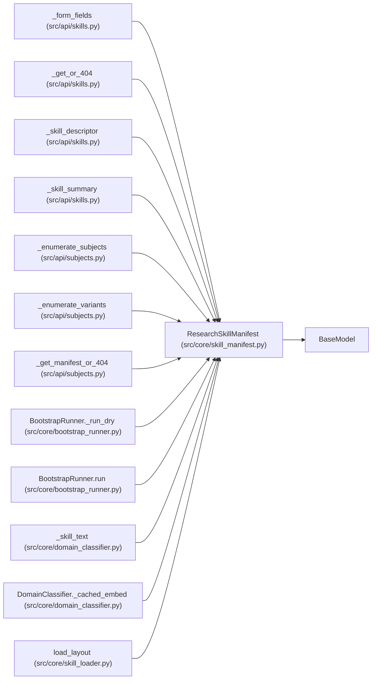

# ResearchSkillManifest

**Location:** `src/core/skill_manifest.py:987`
**Kind:** Pydantic model
**Bases:** `BaseModel`
**Module:** [skill_manifest](../modules/skill_manifest.md)

## Description

A validated ``research_skill.v1`` skill descriptor (ARC-011 P2-001).

Covers every section in ARC-011 §9 plus the G3 ``blocker_classification``
section. Load via ``skill_loader.load_skill_manifest`` (P2-002), which also
resolves ``{settings.*}`` / ``{skill_params.*}`` placeholders (G6) and
applies per-field defaults.

## Model Configuration

| Setting | Value | Source |
|---------|-------|--------|
| `extra` | `'forbid'` | model_config |

## Validators

| Method | Scope | Fields | Mode | Options |
|--------|-------|--------|------|---------|
| `_check_version` | field | schema_version | after | — |
| `_unique_phase_ids` | model | — | after | — |
| `_check_parameter_bindings` | model | — | after | — |
| `_phase_evidence_keys_subset` | model | — | after | — |

## Attributes

| Name | Type | Wire name | Required | Nullable | Default | Constraints | Examples | Description |
|------|------|-----------|----------|----------|---------|-------------|-------------|----------|
| `schema_version` | `str` | `schema_version` | No | No | `SCHEMA_VERSION` | — | — | — |
| `id` | `str` | `id` | Yes | No | — | min_length=1 | — | — |
| `version` | `str` | `version` | Yes | No | — | — | — | — |
| `category` | `Category` | `category` | Yes | No | — | — | — | — |
| `display_name` | `str` | `display_name` | Yes | No | — | — | — | — |
| `description` | `str` | `description` | Yes | No | — | — | — | — |
| `llm` | `LLMConfig` | `llm` | Yes | No | — | — | — | — |
| `workspace` | `WorkspaceConfig` | `workspace` | Yes | No | — | — | — | — |
| `subjects` | `Optional[SubjectsConfig]` | `subjects` | No | Yes | `None` | — | — | — |
| `variants` | `Optional[VariantsConfig]` | `variants` | No | Yes | `None` | — | — | — |
| `param_schema` | `ParamSchema` | `param_schema` | Yes | No | — | — | — | — |
| `metric_schema` | `MetricSchema` | `metric_schema` | Yes | No | — | — | — | — |
| `decision_vocabulary` | `DecisionVocabulary` | `decision_vocabulary` | Yes | No | — | — | — | — |
| `phase_plan` | `list[Phase]` | `phase_plan` | Yes | No | — | min_length=1 | — | — |
| `phase_advancement` | `PhaseAdvancement` | `phase_advancement` | No | No | factory: `PhaseAdvancement` | — | — | — |
| `command_policy` | `CommandPolicy` | `command_policy` | Yes | No | — | — | — | — |
| `output_parser` | `OutputParserConfig` | `output_parser` | Yes | No | — | — | — | — |
| `preflight` | `list[PreflightEntry]` | `preflight` | No | No | factory: `list` | — | — | — |
| `promotion_target` | `PromotionTarget` | `promotion_target` | Yes | No | — | — | — | — |
| `trial_identity` | `Optional[TrialIdentityConfig]` | `trial_identity` | No | Yes | `None` | — | — | — |
| `blocker_classification` | `Optional[BlockerClassification]` | `blocker_classification` | No | Yes | `None` | — | — | — |
| `structured_hpo` | `StructuredHPOConfig` | `structured_hpo` | No | No | factory: `StructuredHPOConfig` | — | — | — |
| `insights` | `Optional[InsightsConfig]` | `insights` | No | Yes | `None` | — | — | — |
| `prompt` | `Optional[PromptConfig]` | `prompt` | No | Yes | `None` | — | — | — |
| `ui` | `Optional[UIConfig]` | `ui` | No | Yes | `None` | — | — | — |
| `parameter_bindings` | `Optional[ParameterBindings]` | `parameter_bindings` | No | Yes | `None` | — | — | — |
| `plugins` | `PluginsConfig` | `plugins` | No | No | factory: `PluginsConfig` | — | — | — |
| `auto_absorb_insights` | `bool` | `auto_absorb_insights` | No | No | `False` | — | — | — |
| `execution` | `Optional[ExecutionConfig]` | `execution` | No | Yes | `None` | — | — | — |
| `knowledge_last_reviewed` | `Optional[str]` | `knowledge_last_reviewed` | No | Yes | `None` | — | — | ISO-8601 timestamp of the last knowledge-corpus review. |
| `refresh_cadence_days` | `Optional[int]` | `refresh_cadence_days` | No | Yes | `None` | ge=1 | — | Days before the UI flags the knowledge corpus as stale. |

## Methods

| Method | Signature | Decorators | Description |
|--------|-----------|------------|-------------|
| `_check_version` | `(value: str) -> str` | `@field_validator('schema_version')`, `@classmethod` | — |
| `_unique_phase_ids` | `() -> 'ResearchSkillManifest'` | `@model_validator(mode='after')` | — |
| `_check_parameter_bindings` | `() -> 'ResearchSkillManifest'` | `@model_validator(mode='after')` | Bindings reference only declared parameters; templates use only the |
| `_phase_evidence_keys_subset` | `() -> 'ResearchSkillManifest'` | `@model_validator(mode='after')` | A per-phase ``advancement`` override must only reference known phases. |

## Relationships

<!-- Auto-generated relationship summary. Do not edit by hand. -->

### Summary

| Module | Methods | Attributes |
|---|---:|---|
| [skill_manifest](../modules/skill_manifest.md) | 4 | `auto_absorb_insights`, `blocker_classification`, `category`, `command_policy`, `decision_vocabulary`, `description`, `display_name`, `execution`, `id`, `insights`, `knowledge_last_reviewed`, `llm` |

### Structure

| Kind | Entity | Module |
|---|---|---|
| Base | `BaseModel` | — |

### References

| Reference | Kind | Source | Call sites |
|---|---|---|---:|
| `_form_fields` | type_reference | [src_api_skills](../modules/src_api_skills.md) | — |
| `_get_or_404` | type_reference | [src_api_skills](../modules/src_api_skills.md) | — |
| `_skill_descriptor` | type_reference | [src_api_skills](../modules/src_api_skills.md) | — |
| `_skill_summary` | type_reference | [src_api_skills](../modules/src_api_skills.md) | — |
| `_enumerate_subjects` | type_reference | [subjects](../modules/subjects.md) | — |
| `_enumerate_variants` | type_reference | [subjects](../modules/subjects.md) | — |
| `_get_manifest_or_404` | type_reference | [subjects](../modules/subjects.md) | — |
| `BootstrapRunner._run_dry` | type_reference | [bootstrap_runner](../modules/bootstrap_runner.md) | — |
| `BootstrapRunner.run` | type_reference | [bootstrap_runner](../modules/bootstrap_runner.md) | — |
| `_skill_text` | type_reference | [domain_classifier](../modules/domain_classifier.md) | — |
| `DomainClassifier._cached_embed` | type_reference | [domain_classifier](../modules/domain_classifier.md) | — |
| `load_layout` | type_reference | [skill_loader](../modules/skill_loader.md) | — |

> References: showing 12 of 27 logical references; 15 omitted by the 12-row generated summary limit.
