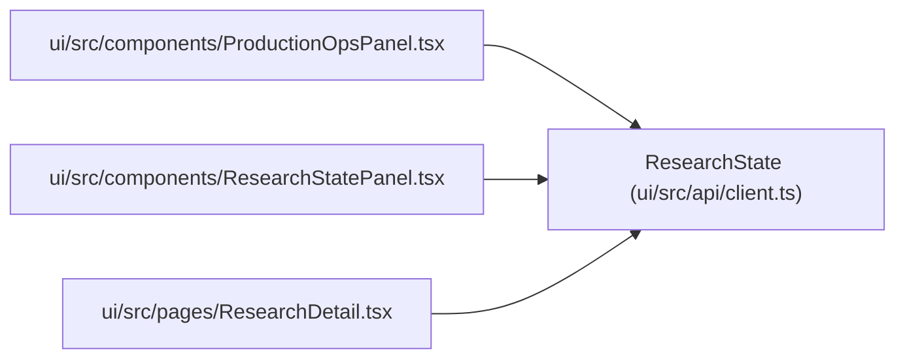

# ResearchState

**Location:** `ui/src/api/client.ts:254`
**Kind:** Class
**Bases:** —
**Module:** [client](../modules/client.md)

## Description

_Auto-generated from `ResearchState` in `ui/src/api/client.ts`._

## Attributes

| Name | Type | Required | Default | Description |
|------|------|----------|---------|-------------|
| `schema_version` | `string` | Yes | — | — |
| `research_id` | `string` | Yes | — | — |
| `model_type` | `string` | Yes | — | — |
| `status` | `string` | Yes | — | — |
| `research_outcome` | `string \| null` | No | — | — |
| `terminal_reason` | `string \| null` | No | — | — |
| `current_phase` | `string \| null` | Yes | — | — |
| `next_action` | `string \| null` | Yes | — | — |
| `phase_state` | `{     schema_version?: string;     research_id?: string;     model_type?: string;     generated_at?: string;     current_phase: string \| null;     next_action: string \| null;     blocked: boolean;     block_reason: string \| null;     all_phases_complete?: boolean;     iterations_in_current_phase?: number;     stalled_iterations?: number;     phases: Array<{       id: string;       label: string;       status: string;       next_action: string;       min_iterations?: number;       max_iterations?: number;     }>;   }` | Yes | — | — |
| `top_candidates` | `Array<Record<string, unknown>>` | Yes | — | — |
| `failed_pruned_configs` | `Array<Record<string, unknown>>` | Yes | — | — |
| `gate_failure_reasons` | `Array<{ iteration: number; blockers: string[] }>` | Yes | — | — |
| `budget_usage` | `{     api_cost_usd: number;     max_budget_usd: number;     iterations_used: number;     max_iterations: number;   }` | Yes | — | — |
| `hpo_studies` | `HpoStudy[]` | Yes | — | — |
| `hpo_study_ids` | `Array<string \| number \| null>` | Yes | — | — |
| `artifact_hashes` | `Array<{ iteration: number; artifact_hash: string }>` | Yes | — | — |
| `mlflow_links` | `Array<{ iteration: number; mlflow_run_id: string }>` | Yes | — | — |
| `promoted_version` | `Promotion \| null` | Yes | — | — |
| `rollback_target` | `string \| null` | Yes | — | — |
| `smoke_status` | `Record<string, unknown> \| null` | Yes | — | — |
| `paper_status` | `unknown` | Yes | — | — |
| `production_operations` | `ProductionOperations \| null` | No | — | — |
| `latest_known_artifacts` | `{     rollback_target?: { value: string; iteration: number };     smoke_status?: { value: Record<string, unknown>; iteration: number };   } \| null` | No | — | — |

## Methods

*No public methods. Inherits from base classes.*

## Relationships

<!-- Auto-generated relationship summary. Do not edit by hand. -->

### Summary

| Module | Methods | Attributes |
|---|---:|---|
| [client](../modules/client.md) | 0 | `artifact_hashes`, `budget_usage`, `current_phase`, `failed_pruned_configs`, `gate_failure_reasons`, `hpo_studies`, `hpo_study_ids`, `latest_known_artifacts`, `mlflow_links`, `model_type`, `next_action`, `paper_status` |

### References

| Reference | Kind | Source | Call sites |
|---|---|---|---:|
| `ProductionOpsPanel` | import | [ProductionOpsPanel](../modules/ProductionOpsPanel.md) | — |
| `ResearchStatePanel` | import | [ResearchStatePanel](../modules/ResearchStatePanel.md) | — |
| `ResearchDetail` | import | [ResearchDetail](../modules/ResearchDetail.md) | — |
