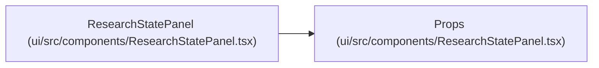

# Props

**Location:** `ui/src/components/ResearchStatePanel.tsx:3`
**Kind:** Class
**Bases:** —
**Module:** [ResearchStatePanel](../modules/ResearchStatePanel.md)

## Description

_Auto-generated from `Props` in `ui/src/components/ResearchStatePanel.tsx`._

## Attributes

| Name | Type | Required | Default | Description |
|------|------|----------|---------|-------------|
| `state` | `ResearchState` | No | — | — |

## Methods

*No public methods. Inherits from base classes.*

## Relationships

<!-- Auto-generated relationship summary. Do not edit by hand. -->

### Summary

| Module | Methods | Attributes |
|---|---:|---|
| [ResearchStatePanel](../modules/ResearchStatePanel.md) | 0 | `state` |

### References

| Reference | Kind | Source | Call sites |
|---|---|---|---:|
| `ResearchStatePanel` | type_reference | [ResearchStatePanel](../modules/ResearchStatePanel.md) | — |
