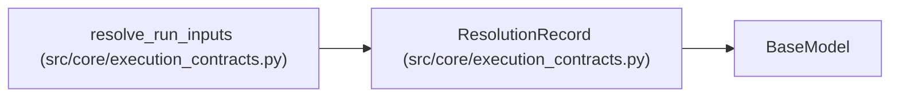

# ResolutionRecord

**Location:** `src/core/execution_contracts.py:1008`
**Kind:** Pydantic model
**Bases:** `BaseModel`
**Module:** [execution_contracts](../modules/execution_contracts.md)

## Description

Provenance of one resolved value — nothing resolves silently.

## Model Configuration

| Setting | Value | Source |
|---------|-------|--------|
| `extra` | `'forbid'` | model_config |

## Attributes

| Name | Type | Wire name | Required | Nullable | Default | Constraints | Examples | Description |
|------|------|-----------|----------|----------|---------|-------------|-------------|----------|
| `field` | `str` | `field` | Yes | No | — | — | — | — |
| `source` | `Literal['explicit', 'skill_default', 'harness_preference', 'system_default']` | `source` | Yes | No | — | — | — | — |
| `requested` | `Optional[Any]` | `requested` | No | Yes | `None` | — | — | — |
| `effective` | `Any` | `effective` | Yes | No | — | — | — | — |
| `bounded` | `bool` | `bounded` | No | No | `False` | — | — | — |

## Methods

*No public methods. Inherits from base classes.*

## Relationships

<!-- Auto-generated relationship summary. Do not edit by hand. -->

### Summary

| Module | Methods | Attributes |
|---|---:|---|
| [execution_contracts](../modules/execution_contracts.md) | 0 | `bounded`, `effective`, `field`, `requested`, `source` |

### Structure

| Kind | Entity | Module |
|---|---|---|
| Base | `BaseModel` | — |

### References

| Reference | Kind | Source | Call sites |
|---|---|---|---:|
| `resolve_run_inputs` | call | [execution_contracts](../modules/execution_contracts.md) | 3 |
