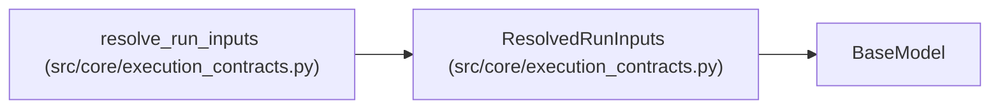

# ResolvedRunInputs

**Location:** `src/core/execution_contracts.py:1020`
**Kind:** Pydantic model
**Bases:** `BaseModel`
**Module:** [execution_contracts](../modules/execution_contracts.md)

## Description

Deterministically resolved inputs with per-field provenance.

## Model Configuration

| Setting | Value | Source |
|---------|-------|--------|
| `extra` | `'forbid'` | model_config |
| `allow_inf_nan` | `False` | model_config |

## Attributes

| Name | Type | Wire name | Required | Nullable | Default | Constraints | Examples | Description |
|------|------|-----------|----------|----------|---------|-------------|-------------|----------|
| `parameters` | `dict[str, Any]` | `parameters` | Yes | No | — | — | — | — |
| `budget` | `BudgetDimensions` | `budget` | Yes | No | — | — | — | — |
| `model_roles` | `dict[str, str]` | `model_roles` | Yes | No | — | — | — | — |
| `records` | `list[ResolutionRecord]` | `records` | Yes | No | — | — | — | — |

## Methods

*No public methods. Inherits from base classes.*

## Relationships

<!-- Auto-generated relationship summary. Do not edit by hand. -->

### Summary

| Module | Methods | Attributes |
|---|---:|---|
| [execution_contracts](../modules/execution_contracts.md) | 0 | `budget`, `model_roles`, `parameters`, `records` |

### Structure

| Kind | Entity | Module |
|---|---|---|
| Base | `BaseModel` | — |

### References

| Reference | Kind | Source | Call sites |
|---|---|---|---:|
| `resolve_run_inputs` | call | [execution_contracts](../modules/execution_contracts.md) | 1 |
| `resolve_run_inputs` | type_reference | [execution_contracts](../modules/execution_contracts.md) | — |
