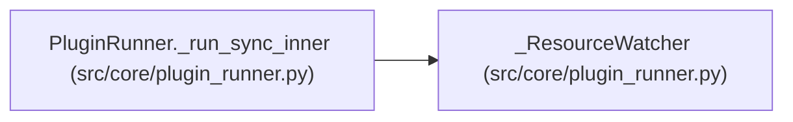

> **Retired source member:** This declaration is no longer in the selected source inventory. The content below is retained history, not current source evidence or an authored lifecycle decision.

# _ResourceWatcher

**Location:** `src/core/plugin_runner.py:510`
**Kind:** Class
**Bases:** —
**Module:** [plugin_runner](../modules/plugin_runner.md)

## Description

Polls a live plugin subprocess's RSS / CPU and flags cap breaches (D6).

The runner checks ``rss_exceeded`` / ``cpu_exceeded`` after ``communicate``
returns; if a cap was breached the tree is killed and the result fails
closed. Sampling cadence (0.1s) balances responsiveness against overhead —
plugins are short-lived (bootstrap/preflight once per session; parser once
per iteration).

## Attributes

*No annotated attributes found.*

## Methods

| Method | Signature | Decorators | Description |
|--------|-----------|------------|-------------|
| `__init__` | `(pid: int, caps: PluginCaps) -> None` | — | — |
| `start` | `() -> None` | — | — |
| `stop` | `() -> None` | — | — |
| `_loop` | `() -> None` | — | — |

## Relationships

<!-- Auto-generated relationship summary. Do not edit by hand. -->

### Summary

| Module | Methods | Attributes |
|---|---:|---|
| [plugin_runner](../modules/plugin_runner.md) | 4 | — |

### References

| Reference | Kind | Source | Call sites |
|---|---|---|---:|
| `PluginRunner._run_sync_inner` | call | [plugin_runner](../modules/plugin_runner.md) | 1 |
