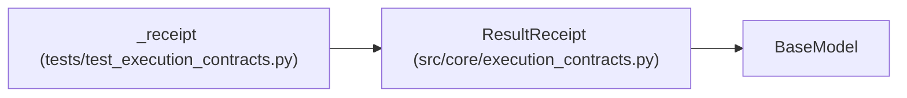

# ResultReceipt

**Location:** `src/core/execution_contracts.py:582`
**Kind:** Pydantic model
**Bases:** `BaseModel`
**Module:** [execution_contracts](../modules/execution_contracts.md)

## Description

Replay protection and ownership for a result envelope.

The receipt binds a result to one evaluator run in one ownership epoch;
a replayed or stale receipt is detectable without trusting the sender's
claims about metrics.

## Model Configuration

| Setting | Value | Source |
|---------|-------|--------|
| `extra` | `'forbid'` | model_config |

## Validators

| Method | Scope | Fields | Mode | Options |
|--------|-------|--------|------|---------|
| `_digest_shape` | field | envelope_digest | after | — |

## Attributes

| Name | Type | Wire name | Required | Nullable | Default | Constraints | Examples | Description |
|------|------|-----------|----------|----------|---------|-------------|-------------|----------|
| `receipt_id` | `str` | `receipt_id` | Yes | No | — | min_length=1 | — | — |
| `nonce` | `str` | `nonce` | Yes | No | — | min_length=1 | — | — |
| `ownership_epoch` | `int` | `ownership_epoch` | Yes | No | — | ge=1 | — | — |
| `sequence` | `int` | `sequence` | Yes | No | — | ge=0 | — | — |
| `envelope_digest` | `str` | `envelope_digest` | Yes | No | — | — | — | — |

## Methods

| Method | Signature | Decorators | Description |
|--------|-----------|------------|-------------|
| `_digest_shape` | `(value: str) -> str` | `@field_validator('envelope_digest')`, `@classmethod` | — |

## Relationships

<!-- Auto-generated relationship summary. Do not edit by hand. -->

### Summary

| Module | Methods | Attributes |
|---|---:|---|
| [execution_contracts](../modules/execution_contracts.md) | 1 | `envelope_digest`, `nonce`, `ownership_epoch`, `receipt_id`, `sequence` |

### Structure

| Kind | Entity | Module |
|---|---|---|
| Base | `BaseModel` | — |

### References

| Reference | Kind | Source | Call sites |
|---|---|---|---:|
| `_receipt` | call | [test_execution_contracts](../modules/test_execution_contracts.md) | 1 |
