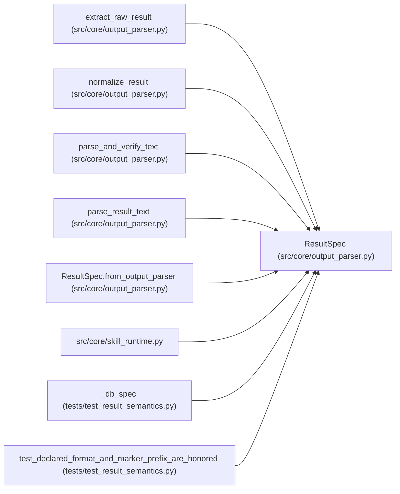

# ResultSpec

**Location:** `src/core/output_parser.py:123`
**Kind:** Class
**Bases:** —
**Module:** [output_parser](../modules/output_parser.md)

**Decorators:** `@dataclass(frozen=True)`

## Description

The declared result semantics (built from ``output_parser``).

``failure_statuses`` is the declared list unioned with the core
:data:`FAILURE_STATUSES` — a run whose status is in the set is a
non-winning outcome regardless of which side declared it.

## Attributes

| Name | Type | Default | Description |
|------|------|---------|-------------|
| `format` | `str` | `'json_marker'` | — |
| `marker_prefix` | `str` | `_ITERATION_MARKER` | — |
| `block_delimiter` | `str` | `'---'` | — |
| `required_fields` | `tuple[str, ...]` | `()` | — |
| `field_types` | `Mapping[str, str]` | `dataclass_field(default_factory=dict)` | — |
| `failure_statuses` | `frozenset[str]` | `FAILURE_STATUSES` | — |
| `schema_versions` | `frozenset[str]` | `frozenset({RESULT_SCHEMA_VERSION})` | — |

## Methods

| Method | Signature | Decorators | Description |
|--------|-----------|------------|-------------|
| `from_output_parser` | `(op: Any) -> 'ResultSpec'` | `@classmethod` | Build the spec from a manifest ``OutputParserConfig`` (or None). |

## Relationships

<!-- Auto-generated relationship summary. Do not edit by hand. -->

### Summary

| Module | Methods | Attributes |
|---|---:|---|
| [output_parser](../modules/output_parser.md) | 1 | `block_delimiter`, `failure_statuses`, `field_types`, `format`, `marker_prefix`, `required_fields`, `schema_versions` |

### References

| Reference | Kind | Source | Call sites |
|---|---|---|---:|
| `extract_raw_result` | type_reference | [output_parser](../modules/output_parser.md) | — |
| `normalize_result` | type_reference | [output_parser](../modules/output_parser.md) | — |
| `parse_and_verify_text` | type_reference | [output_parser](../modules/output_parser.md) | — |
| `parse_result_text` | type_reference | [output_parser](../modules/output_parser.md) | — |
| `ResultSpec.from_output_parser` | call | [output_parser](../modules/output_parser.md) | 2 |
| `ResultSpec.from_output_parser` | type_reference | [output_parser](../modules/output_parser.md) | — |
| `skill_runtime` | import | [skill_runtime](../modules/skill_runtime.md) | — |
| `_db_spec` | type_reference | [test_result_semantics](../modules/test_result_semantics.md) | — |
| `test_declared_format_and_marker_prefix_are_honored` | call | [test_result_semantics](../modules/test_result_semantics.md) | 2 |
