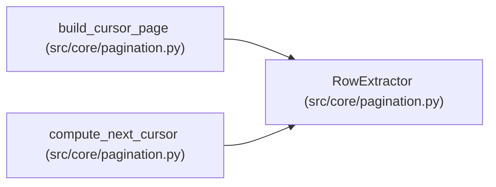

# RowExtractor

**Location:** `src/core/pagination.py:31`
**Kind:** Type alias
**Bases:** —
**Module:** [pagination](../modules/pagination.md)
**Target:** `Callable[[Mapping[str, Any]], CursorTuple]`

## Description

_Auto-generated from `RowExtractor` in `src/core/pagination.py`._

## Attributes

*No annotated attributes found.*

## Methods

*No public methods. Inherits from base classes.*

## Relationships

<!-- Auto-generated relationship summary. Do not edit by hand. -->

### Summary

| Module | Methods | Attributes |
|---|---:|---|
| [pagination](../modules/pagination.md) | 0 | — |

### References

| Reference | Kind | Source | Call sites |
|---|---|---|---:|
| `build_cursor_page` | type_reference | [pagination](../modules/pagination.md) | — |
| `compute_next_cursor` | type_reference | [pagination](../modules/pagination.md) | — |
