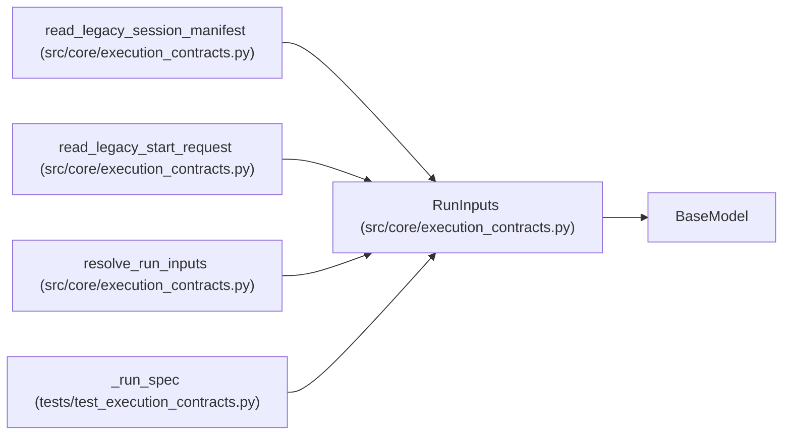

# RunInputs

**Location:** `src/core/execution_contracts.py:821`
**Kind:** Pydantic model
**Bases:** `BaseModel`
**Module:** [execution_contracts](../modules/execution_contracts.md)

## Description

Pinned input identities: what the run evaluates against.

## Model Configuration

| Setting | Value | Source |
|---------|-------|--------|
| `extra` | `'forbid'` | model_config |

## Validators

| Method | Scope | Fields | Mode | Options |
|--------|-------|--------|------|---------|
| `_digests_shape` | field | candidate_input_digests, dataset_digests | after | — |
| `_digest_shape` | field | evaluator_digest | after | — |

## Attributes

| Name | Type | Wire name | Required | Nullable | Default | Constraints | Examples | Description |
|------|------|-----------|----------|----------|---------|-------------|-------------|----------|
| `candidate_input_digests` | `list[str]` | `candidate_input_digests` | No | No | factory: `list` | — | — | — |
| `evaluator_digest` | `str` | `evaluator_digest` | Yes | No | — | — | — | — |
| `dataset_digests` | `list[str]` | `dataset_digests` | Yes | No | — | min_length=1 | — | — |
| `environment` | `EnvironmentIdentity` | `environment` | Yes | No | — | — | — | — |

## Methods

| Method | Signature | Decorators | Description |
|--------|-----------|------------|-------------|
| `_digests_shape` | `(value: list[str]) -> list[str]` | `@field_validator('candidate_input_digests', 'dataset_digests')`, `@classmethod` | — |
| `_digest_shape` | `(value: str) -> str` | `@field_validator('evaluator_digest')`, `@classmethod` | — |

## Relationships

<!-- Auto-generated relationship summary. Do not edit by hand. -->

### Summary

| Module | Methods | Attributes |
|---|---:|---|
| [execution_contracts](../modules/execution_contracts.md) | 2 | `candidate_input_digests`, `dataset_digests`, `environment`, `evaluator_digest` |

### Structure

| Kind | Entity | Module |
|---|---|---|
| Base | `BaseModel` | — |

### References

| Reference | Kind | Source | Call sites |
|---|---|---|---:|
| `read_legacy_session_manifest` | type_reference | [execution_contracts](../modules/execution_contracts.md) | — |
| `read_legacy_start_request` | type_reference | [execution_contracts](../modules/execution_contracts.md) | — |
| `resolve_run_inputs` | type_reference | [execution_contracts](../modules/execution_contracts.md) | — |
| `_run_spec` | call | [test_execution_contracts](../modules/test_execution_contracts.md) | 1 |
