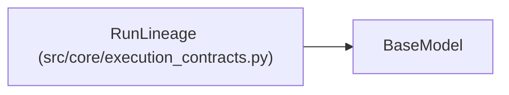

# RunLineage

**Location:** `src/core/execution_contracts.py:842`
**Kind:** Pydantic model
**Bases:** `BaseModel`
**Module:** [execution_contracts](../modules/execution_contracts.md)

## Description

Continuation provenance: where this run came from and how to resume.

## Model Configuration

| Setting | Value | Source |
|---------|-------|--------|
| `extra` | `'forbid'` | model_config |

## Attributes

| Name | Type | Wire name | Required | Nullable | Default | Constraints | Examples | Description |
|------|------|-----------|----------|----------|---------|-------------|-------------|----------|
| `parent_run_id` | `Optional[str]` | `parent_run_id` | No | Yes | `None` | — | — | — |
| `checkpoint_refs` | `list[str]` | `checkpoint_refs` | No | No | factory: `list` | — | — | — |
| `focus_hint` | `Optional[str]` | `focus_hint` | No | Yes | `None` | — | — | — |

## Methods

*No public methods. Inherits from base classes.*

## Relationships

<!-- Auto-generated relationship summary. Do not edit by hand. -->

### Summary

| Module | Methods | Attributes |
|---|---:|---|
| [execution_contracts](../modules/execution_contracts.md) | 0 | `checkpoint_refs`, `focus_hint`, `parent_run_id` |

### Structure

| Kind | Entity | Module |
|---|---|---|
| Base | `BaseModel` | — |
