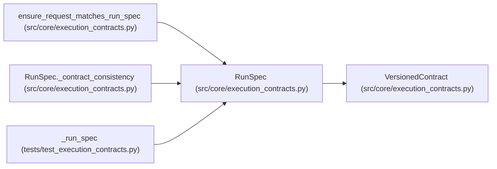

# RunSpec

**Location:** `src/core/execution_contracts.py:852`
**Kind:** Pydantic model
**Bases:** `VersionedContract`
**Module:** [execution_contracts](../modules/execution_contracts.md)

## Description

The persisted, fully resolved run specification.

Everything needed to reproduce and audit a run is pinned here: skill
package identity and validated nonsecret parameters, harness identity
and scalar effective configuration, input digests and environment
identity, capability and policy versions, budget dimensions, objective
policy, continuation lineage, and immutable artifact locations.

Mutable candidate data never appears inline — candidates are bound by
digest. Credentials appear only as :class:`SecretReference` records.

## Model Configuration

| Setting | Value | Source |
|---------|-------|--------|
| `extra` | `'forbid'` | model_config |
| `allow_inf_nan` | `False` | model_config |

## Validators

| Method | Scope | Fields | Mode | Options |
|--------|-------|--------|------|---------|
| `_contract_consistency` | model | — | after | — |

## Attributes

| Name | Type | Wire name | Required | Nullable | Default | Constraints | Examples | Description |
|------|------|-----------|----------|----------|---------|-------------|-------------|----------|
| `schema_version` | `str` | `schema_version` | No | No | `RUN_SPEC_SCHEMA_VERSION` | — | — | — |
| `run_id` | `str` | `run_id` | Yes | No | — | min_length=1 | — | — |
| `integration` | `IntegrationDirection` | `integration` | Yes | No | — | — | — | — |
| `skill` | `SkillPackageRef` | `skill` | Yes | No | — | — | — | — |
| `parameters` | `dict[str, Any]` | `parameters` | No | No | factory: `dict` | — | — | — |
| `harness` | `HarnessConfig` | `harness` | Yes | No | — | — | — | — |
| `inputs` | `RunInputs` | `inputs` | Yes | No | — | — | — | — |
| `capabilities` | `CapabilityDescriptor` | `capabilities` | Yes | No | — | — | — | — |
| `isolation` | `IsolationBoundary` | `isolation` | Yes | No | — | — | — | — |
| `policy_version` | `str` | `policy_version` | Yes | No | — | min_length=1 | — | — |
| `budget` | `BudgetDimensions` | `budget` | Yes | No | — | — | — | — |
| `objective` | `ObjectivePolicy` | `objective` | Yes | No | — | — | — | — |
| `lineage` | `RunLineage` | `lineage` | No | No | factory: `RunLineage` | — | — | — |
| `artifacts` | `list[ArtifactRef]` | `artifacts` | No | No | factory: `list` | — | — | — |
| `secrets` | `list[SecretReference]` | `secrets` | No | No | factory: `list` | — | — | — |

## Methods

| Method | Signature | Decorators | Description |
|--------|-----------|------------|-------------|
| `_contract_consistency` | `() -> 'RunSpec'` | `@model_validator(mode='after')` | — |
| `spec_digest` | `() -> str` | — | Canonical digest of the resolved specification. |

## Relationships

<!-- Auto-generated relationship summary. Do not edit by hand. -->

### Summary

| Module | Methods | Attributes |
|---|---:|---|
| [execution_contracts](../modules/execution_contracts.md) | 2 | `artifacts`, `budget`, `capabilities`, `harness`, `inputs`, `integration`, `isolation`, `lineage`, `objective`, `parameters`, `policy_version`, `run_id` |

### Structure

| Kind | Entity | Module |
|---|---|---|
| Base | `VersionedContract` | [execution_contracts](../modules/execution_contracts.md) |

### References

| Reference | Kind | Source | Call sites |
|---|---|---|---:|
| `ensure_request_matches_run_spec` | type_reference | [execution_contracts](../modules/execution_contracts.md) | — |
| `RunSpec._contract_consistency` | type_reference | [execution_contracts](../modules/execution_contracts.md) | — |
| `_run_spec` | call | [test_execution_contracts](../modules/test_execution_contracts.md) | 1 |
