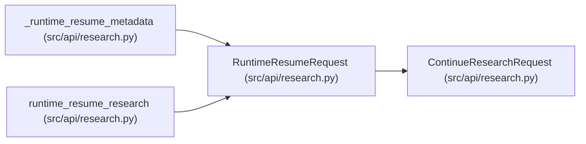

# RuntimeResumeRequest

**Location:** `src/api/research.py:908`
**Kind:** Pydantic model
**Bases:** `ContinueResearchRequest`
**Module:** [research](../modules/research.md)

## Description

Explicit operator action for resuming a restart-recovered session.

## Attributes

| Name | Type | Wire name | Required | Nullable | Default | Constraints | Examples | Description |
|------|------|-----------|----------|----------|---------|-------------|-------------|----------|
| `reason` | `str` | `reason` | Yes | No | — | max_length=1000; min_length=3 | — | Operator reason for resuming the interrupted session. |
| `allow_interrupted` | `bool` | `allow_interrupted` | No | No | `False` | — | — | Allow resume from interrupted state when evidence is incomplete. |

## Methods

*No public methods. Inherits from base classes.*

## Relationships

<!-- Auto-generated relationship summary. Do not edit by hand. -->

### Summary

| Module | Methods | Attributes |
|---|---:|---|
| [research](../modules/research.md) | 0 | `allow_interrupted`, `reason` |

### Structure

| Kind | Entity | Module |
|---|---|---|
| Base | `ContinueResearchRequest` | [research](../modules/research.md) |

### References

| Reference | Kind | Source | Call sites |
|---|---|---|---:|
| `_runtime_resume_metadata` | type_reference | [research](../modules/research.md) | — |
| `runtime_resume_research` | type_reference | [research](../modules/research.md) | — |
