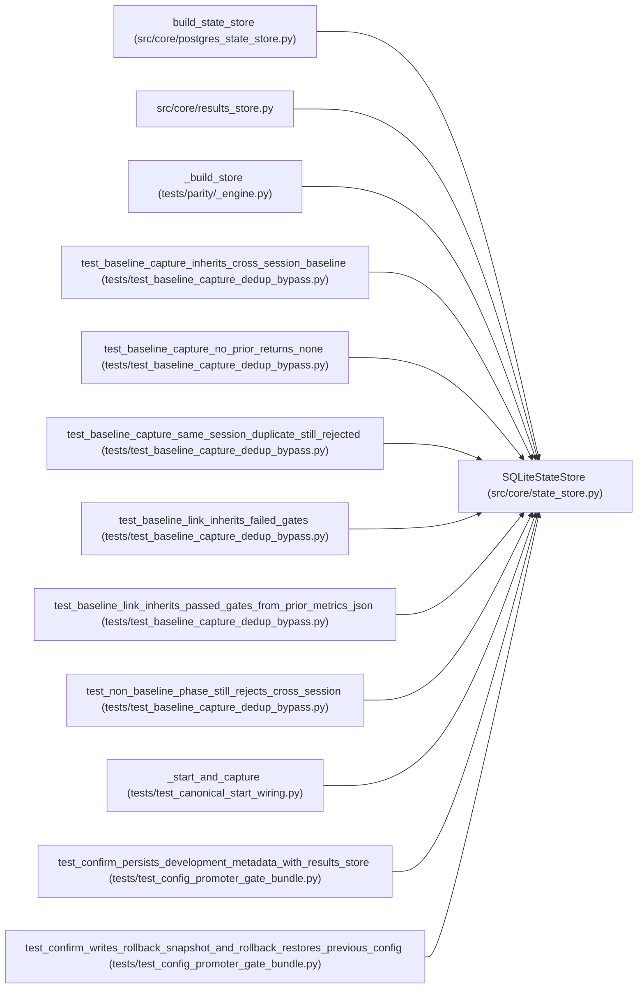

# SQLiteStateStore

**Location:** `src/core/state_store.py:1295`
**Kind:** Class
**Bases:** —
**Module:** [state_store](../modules/state_store.md)

## Description

SQLite-specific implementation of :class:`StateStore`.

Owns the schema DDL (``_SCHEMA_SQL``) and the migration registry
(``_MIGRATIONS``, P1-007 AC #4) — these are SQLite concerns and stay inside
this implementation, never on the protocol.

**Single-instance constraint (W14):** SQLite is single-writer, so this store
cannot back a horizontally-scaled deployment. The runtime *guard* that
rejects ``WEB_CONCURRENCY > 1`` lives in ``src/main.py``
(``_validate_runtime_configuration``), not here — it is a service-lifecycle
concern that is **conditional on the backend** (ARC-011 P6-006): the guard
rejects >1 when ``settings.database_url`` is unset/SQLite (today's default,
byte-identical), and allows >1 when it points at Postgres.
``PostgresStateStore`` (P6-002) is the ceiling-lifter.

## Attributes

*No annotated attributes found.*

## Methods

| Method | Signature | Decorators | Description |
|--------|-----------|------------|-------------|
| `__init__` | `(db_path: str) -> None` | — | — |
| `initialize` | *(async)* `() -> None` | — | — |
| `connection` | *(async)* `() -> AsyncIterator[aiosqlite.Connection]` | `@asynccontextmanager` | Yield the long-lived SQLite connection initialized at startup. |
| `close` | *(async)* `() -> None` | — | Flush and close the long-lived SQLite connection. |
| `ping` | *(async)* `() -> bool` | — | Return True when the persistent DB connection can answer a query. |
| `get_schema_version` | *(async)* `() -> int` | — | — |
| `session_lock` | *(async)* `(session_id: str) -> AsyncIterator[None]` | `@asynccontextmanager` | No-op for SQLite (ARC-011 P6-003). |
| `bump_session_epoch` | *(async)* `(session_id: str) -> None` | — | No-op for SQLite (ARC-011 P6-003). Single-worker ⇒ no stale writers. |
| `begin_idempotency_record` | *(async)* `(*, operation: str, parent_id: str, key_hash: str, request_hash: str) -> Optional[Dict[str, Any]]` | — | Reserve an idempotency key or return the existing record. |
| `complete_idempotency_record` | *(async)* `(*, operation: str, parent_id: str, key_hash: str, child_id: Optional[str], response: Dict[str, Any]) -> None` | — | — |
| `delete_idempotency_record` | *(async)* `(*, operation: str, parent_id: str, key_hash: str) -> None` | — | — |
| `record_audit_event` | *(async)* `(*, actor_id: str, action: str, outcome: str, research_id: Optional[str] = None, pipeline_id: Optional[str] = None, request_metadata: Optional[Dict[str, Any]] = None, error_message: Optional[str] = None) -> Dict[str, Any]` | — | — |
| `list_audit_events` | *(async)* `(*, limit: int = 100, action: Optional[str] = None, research_id: Optional[str] = None, pipeline_id: Optional[str] = None) -> List[Dict[str, Any]]` | — | — |
| `create_session` | *(async)* `(*, session_id: str, instrument: str, timeframe: str, model_type: str, tag: str, quick_mode: bool, max_iterations: int, max_budget_usd: float, focus_hint: Optional[str], workspace_path: str, manifest_json: Optional[str] = None, manifest_path: Optional[str] = None, manifest_hash: Optional[str] = None, skill_id: Optional[str] = None, subject_id: Optional[str] = None, variant: Optional[str] = None) -> Dict[str, Any]` | — | — |
| `get_session` | *(async)* `(session_id: str) -> Optional[Dict[str, Any]]` | — | — |
| `list_sessions` | *(async)* `(status: Optional[str] = None, model_type: Optional[str] = None, instrument: Optional[str] = None, status_in: Optional[Sequence[str]] = None, limit: Optional[int] = None, offset: int = 0, cursor: Optional[tuple[Any, int]] = None, reverse: bool = False) -> List[Dict[str, Any]]` | — | — |
| `count_sessions` | *(async)* `(status: Optional[str] = None, model_type: Optional[str] = None, instrument: Optional[str] = None, status_in: Optional[Sequence[str]] = None) -> int` | — | Phase 5.1: total count for paginated listings. |
| `record_runtime_command` | *(async)* `(*, research_id: str, turn: Optional[int], tool_name: str, command: Optional[str] = None, normalized_command: Optional[str] = None, policy_operation: Optional[str] = None, timeout_s: Optional[int] = None, metadata: Optional[Dict[str, Any]] = None) -> Dict[str, Any]` | — | — |
| `finish_runtime_command` | *(async)* `(command_id: int, *, status: str, returncode: Optional[int] = None, timed_out: bool = False, output_preview: Optional[str] = None, error_message: Optional[str] = None, metadata: Optional[Dict[str, Any]] = None) -> Optional[Dict[str, Any]]` | — | — |
| `list_runtime_commands` | *(async)* `(*, research_id: Optional[str] = None, status: Optional[str] = None, command_id: Optional[int] = None) -> List[Dict[str, Any]]` | — | — |
| `collect_observability_metrics` | *(async)* `(*, active_sessions: int = 0) -> Dict[str, Any]` | — | Collect production research metrics from persisted state. |
| `interrupt_runtime_commands` | *(async)* `(*, research_id: str, reason: str) -> int` | — | — |
| `update_session` | *(async)* `(session_id: str, *, lock_epoch: Optional[int] = None, **fields: Any) -> Optional[Dict[str, Any]]` | — | — |
| `delete_session` | *(async)* `(session_id: str) -> bool` | — | — |
| `add_iteration` | *(async)* `(*, research_id: str, iteration: int, primary_metric: Optional[float], metric_name: Optional[str], all_gates_passed: Optional[bool], decision: Optional[str], description: Optional[str], config_snapshot: Optional[str], metrics_json: Optional[str], training_time_s: Optional[float], api_cost_usd: float = 0.0, mlflow_run_id: Optional[str] = None, canonical_config_hash: Optional[str] = None, trial_identity_hash: Optional[str] = None, trial_identity_json: Optional[str] = None, duplicate_of_research_id: Optional[str] = None, duplicate_of_iteration: Optional[int] = None, duplicate_reason: Optional[str] = None, attempt_snapshot_json: Optional[str] = None, attempt_snapshot_path: Optional[str] = None, attempt_snapshot_hash: Optional[str] = None, consistency_report_json: Optional[str] = None, search_phase: Optional[str] = None, metric_improvement_epsilon: float = 0.0, lock_epoch: Optional[int] = None) -> Dict[str, Any]` | — | — |
| `get_iterations` | *(async)* `(research_id: str, limit: Optional[int] = None, cursor: Optional[tuple[Any, int]] = None, reverse: bool = False) -> List[Dict[str, Any]]` | — | — |
| `get_cross_session_iteration_summary` | *(async)* `(*, instrument: str, timeframe: str, model_type: str, exclude_research_id: Optional[str] = None, limit: int = 500) -> List[Dict[str, Any]]` | — | Compact summary of iterations from OTHER sessions for the same |
| `update_iteration` | *(async)* `(research_id: str, iteration: int, marker: Dict[str, Any]) -> None` | — | Overwrite an existing iteration with richer data from an explicit |
| `get_iteration` | *(async)* `(research_id: str, iteration: int) -> Optional[Dict[str, Any]]` | — | — |
| `find_duplicate_trial_identity` | *(async)* `(*, research_id: str, trial_identity_hash: str, instrument: str, timeframe: str, model_type: str, include_cross_session: bool = False) -> Optional[Dict[str, Any]]` | — | Return an existing attempt with the same trial identity hash. |
| `get_best_iteration` | *(async)* `(research_id: str) -> Optional[Dict[str, Any]]` | — | — |
| `get_latest_iteration_with_config_snapshot` | *(async)* `(research_id: str) -> Optional[Dict[str, Any]]` | — | Return the most recent iteration row whose config_snapshot is non-null. |
| `get_first_iteration_with_config_snapshot` | *(async)* `(research_id: str) -> Optional[Dict[str, Any]]` | — | Return the earliest iteration row whose config_snapshot is non-null. |
| `add_hpo_study` | *(async)* `(*, research_id: str, iteration: int, n_trials: int, completed_trials: int, best_composite: Optional[float], training_time_s: Optional[float], top_trials_json: Optional[str], status: str = 'completed', study_id: Optional[str] = None, max_trials: Optional[int] = None, search_space_json: Optional[str] = None, budget_json: Optional[str] = None, timeout_s: Optional[int] = None, quick_mode: bool = False) -> Dict[str, Any]` | — | — |
| `record_hpo_study_plan` | *(async)* `(*, research_id: str, study_id: str, max_trials: int, search_space_json: str, budget_json: str, timeout_s: int, quick_mode: bool) -> Dict[str, Any]` | — | Persist a planned structured HPO study before training starts. |
| `get_hpo_studies` | *(async)* `(research_id: str) -> List[Dict[str, Any]]` | — | — |
| `record_planned_trials` | *(async)* `(*, research_id: str, study_id: Optional[str], trials: List[Dict[str, Any]]) -> List[Dict[str, Any]]` | — | Persist server-owned planned trials before execution. |
| `record_planned_trial_manual_review` | *(async)* `(*, research_id: str, study_id: Optional[str], expected_command: str, reason: str, search_phase: str = 'manual_review', config_patch: Optional[Dict[str, Any]] = None) -> Dict[str, Any]` | — | Record an off-plan structured HPO proposal for operator review. |
| `get_planned_trials` | *(async)* `(research_id: str) -> List[Dict[str, Any]]` | — | — |
| `get_planned_trial` | *(async)* `(research_id: str, trial_id: str) -> Optional[Dict[str, Any]]` | — | — |
| `get_planned_trial_for_command` | *(async)* `(research_id: str, expected_command: str) -> Optional[Dict[str, Any]]` | — | — |
| `update_planned_trial_status` | *(async)* `(*, research_id: str, trial_id: str, status: str, result_path: Optional[str] = None, mlflow_run_id: Optional[str] = None, manual_review_reason: Optional[str] = None, train_config_path: Optional[str] = None, canonical_config_hash: Optional[str] = None, trial_identity_hash: Optional[str] = None, trial_identity: Optional[Dict[str, Any]] = None, trial_identity_json: Optional[str] = None) -> Optional[Dict[str, Any]]` | — | — |
| `_decode_planned_trial` | `(row: Dict[str, Any]) -> None` | `@staticmethod` | — |
| `record_promotion` | *(async)* `(*, research_id: str, iteration: int, model_type: str, instrument: str, timeframe: str, target_path: str, config_yaml: str, previous_yaml: Optional[str], scope: str = 'development', metadata_path: Optional[str] = None, promotion_metadata: Optional[Dict[str, Any]] = None) -> Dict[str, Any]` | — | — |
| `list_promotions` | *(async)* `() -> List[Dict[str, Any]]` | — | — |
| `get_latest_development_promotion` | *(async)* `(*, model_type: str, instrument: str, timeframe: str) -> Optional[Dict[str, Any]]` | — | — |
| `get_latest_promotion` | *(async)* `(*, model_type: str, instrument: str, timeframe: str, scope: str) -> Optional[Dict[str, Any]]` | — | — |
| `record_promotion_rollback` | *(async)* `(*, promotion_id: int, rollback_metadata_path: str, rollback_metadata: Dict[str, Any]) -> Optional[Dict[str, Any]]` | — | — |
| `_decode_promotion_metadata` | `(row: Dict[str, Any]) -> None` | `@staticmethod` | — |
| `create_pipeline` | *(async)* `(*, pipeline_id: str, instrument: str, timeframe: str, tag: str, max_iterations: int, max_budget_usd: float, quick_mode: bool, timeout_s: int, focus_hint: Optional[str], phase_budgets: Optional[str], trading_mode: Optional[str], agent_strategy: Optional[str], initial_balance: Optional[float], enable_hpo: bool, hpo_trials: Optional[int], hpo_timesteps: Optional[int]) -> Dict[str, Any]` | — | — |
| `get_pipeline` | *(async)* `(pipeline_id: str) -> Optional[Dict[str, Any]]` | — | — |
| `list_pipelines` | *(async)* `(status: Optional[str] = None, instrument: Optional[str] = None, limit: Optional[int] = None, offset: int = 0, cursor: Optional[tuple[Any, int]] = None, reverse: bool = False) -> List[Dict[str, Any]]` | — | — |
| `count_pipelines` | *(async)* `(status: Optional[str] = None, instrument: Optional[str] = None) -> int` | — | Phase 5.1: total count for paginated pipeline listings. |
| `update_pipeline` | *(async)* `(pipeline_id: str, **fields: Any) -> Optional[Dict[str, Any]]` | — | — |
| `_decode_pipeline_metadata` | `(row: Dict[str, Any]) -> None` | `@staticmethod` | — |

## Relationships

<!-- Auto-generated relationship summary. Do not edit by hand. -->

### Summary

| Module | Methods | Attributes |
|---|---:|---|
| [state_store](../modules/state_store.md) | 55 | — |

### References

| Reference | Kind | Source | Call sites |
|---|---|---|---:|
| `build_state_store` | call | [postgres_state_store](../modules/postgres_state_store.md) | 1 |
| `results_store` | import | [results_store](../modules/results_store.md) | — |
| `_build_store` | call | [_engine](../modules/_engine.md) | 1 |
| `test_baseline_capture_inherits_cross_session_baseline` | call | [test_baseline_capture_dedup_bypass](../modules/test_baseline_capture_dedup_bypass.md) | 1 |
| `test_baseline_capture_no_prior_returns_none` | call | [test_baseline_capture_dedup_bypass](../modules/test_baseline_capture_dedup_bypass.md) | 1 |
| `test_baseline_capture_same_session_duplicate_still_rejected` | call | [test_baseline_capture_dedup_bypass](../modules/test_baseline_capture_dedup_bypass.md) | 1 |
| `test_baseline_link_inherits_failed_gates` | call | [test_baseline_capture_dedup_bypass](../modules/test_baseline_capture_dedup_bypass.md) | 1 |
| `test_baseline_link_inherits_passed_gates_from_prior_metrics_json` | call | [test_baseline_capture_dedup_bypass](../modules/test_baseline_capture_dedup_bypass.md) | 1 |
| `test_non_baseline_phase_still_rejects_cross_session` | call | [test_baseline_capture_dedup_bypass](../modules/test_baseline_capture_dedup_bypass.md) | 1 |
| `_start_and_capture` | call | [test_canonical_start_wiring](../modules/test_canonical_start_wiring.md) | 1 |
| `test_confirm_persists_development_metadata_with_results_store` | call | [test_config_promoter_gate_bundle](../modules/test_config_promoter_gate_bundle.md) | 1 |
| `test_confirm_writes_rollback_snapshot_and_rollback_restores_previous_config` | call | [test_config_promoter_gate_bundle](../modules/test_config_promoter_gate_bundle.md) | 1 |

> References: showing 12 of 116 logical references; 104 omitted by the 12-row generated summary limit.
