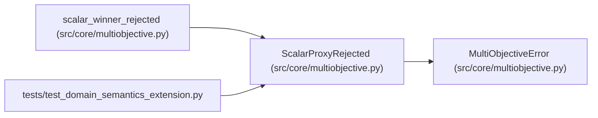

# ScalarProxyRejected

**Location:** `src/core/multiobjective.py:25`
**Kind:** Class
**Bases:** `MultiObjectiveError`
**Module:** [multiobjective](../modules/multiobjective.md)

## Description

A scalar winner cannot stand in for a multiobjective requirement.

## Attributes

*No annotated attributes found.*

## Methods

*No public methods. Inherits from base classes.*

## Relationships

<!-- Auto-generated relationship summary. Do not edit by hand. -->

### Summary

| Module | Methods | Attributes |
|---|---:|---|
| [multiobjective](../modules/multiobjective.md) | 0 | — |

### Structure

| Kind | Entity | Module |
|---|---|---|
| Base | `MultiObjectiveError` | [multiobjective](../modules/multiobjective.md) |

### References

| Reference | Kind | Source | Call sites |
|---|---|---|---:|
| `scalar_winner_rejected` | call | [multiobjective](../modules/multiobjective.md) | 1 |
| `test_domain_semantics_extension` | import | [test_domain_semantics_extension](../modules/test_domain_semantics_extension.md) | — |
