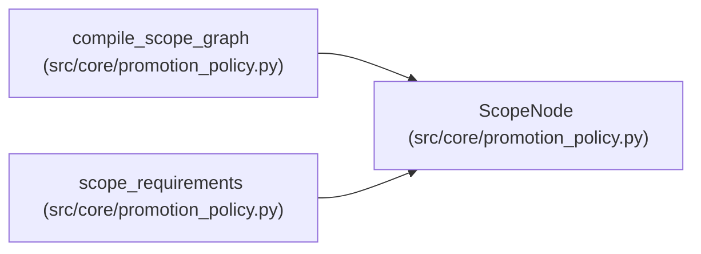

# ScopeNode

**Location:** `src/core/promotion_policy.py:41`
**Kind:** Class
**Bases:** —
**Module:** [promotion_policy](../modules/promotion_policy.md)

**Decorators:** `@dataclass(frozen=True)`

## Description

One compiled scope: its approval constraint, dependencies, evidence.

## Attributes

| Name | Type | Default | Description |
|------|------|---------|-------------|
| `id` | `str` | *required* | — |
| `approval_required` | `bool` | `False` | — |
| `prior_scopes` | `tuple[str, ...]` | `()` | — |
| `evidence` | `tuple[str, ...]` | `()` | — |

## Methods

*No public methods. Inherits from base classes.*

## Relationships

<!-- Auto-generated relationship summary. Do not edit by hand. -->

### Summary

| Module | Methods | Attributes |
|---|---:|---|
| [promotion_policy](../modules/promotion_policy.md) | 0 | `approval_required`, `evidence`, `id`, `prior_scopes` |

### References

| Reference | Kind | Source | Call sites |
|---|---|---|---:|
| `compile_scope_graph` | call | [promotion_policy](../modules/promotion_policy.md) | 1 |
| `compile_scope_graph` | type_reference | [promotion_policy](../modules/promotion_policy.md) | — |
| `scope_requirements` | type_reference | [promotion_policy](../modules/promotion_policy.md) | — |
