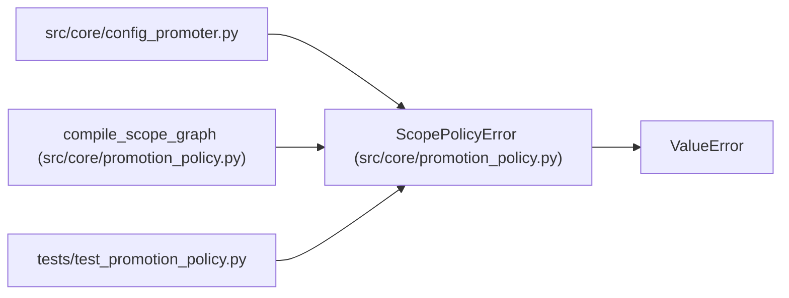

# ScopePolicyError

**Location:** `src/core/promotion_policy.py:20`
**Kind:** Class
**Bases:** `ValueError`
**Module:** [promotion_policy](../modules/promotion_policy.md)

## Description

Raised for invalid or unimplementable scope declarations.

## Attributes

*No annotated attributes found.*

## Methods

*No public methods. Inherits from base classes.*

## Relationships

<!-- Auto-generated relationship summary. Do not edit by hand. -->

### Summary

| Module | Methods | Attributes |
|---|---:|---|
| [promotion_policy](../modules/promotion_policy.md) | 0 | — |

### Structure

| Kind | Entity | Module |
|---|---|---|
| Base | `ValueError` | — |

### References

| Reference | Kind | Source | Call sites |
|---|---|---|---:|
| `config_promoter` | import | [config_promoter](../modules/config_promoter.md) | — |
| `compile_scope_graph` | call | [promotion_policy](../modules/promotion_policy.md) | 4 |
| `test_promotion_policy` | import | [test_promotion_policy](../modules/test_promotion_policy.md) | — |
