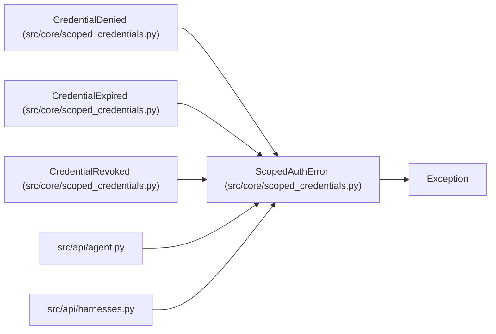

# ScopedAuthError

**Location:** `src/core/scoped_credentials.py:34`
**Kind:** Class
**Bases:** `Exception`
**Module:** [scoped_credentials](../modules/scoped_credentials.md)

## Description

A scoped credential was refused.

## Attributes

*No annotated attributes found.*

## Methods

*No public methods. Inherits from base classes.*

## Relationships

<!-- Auto-generated relationship summary. Do not edit by hand. -->

### Summary

| Module | Methods | Attributes |
|---|---:|---|
| [scoped_credentials](../modules/scoped_credentials.md) | 0 | — |

### Structure

| Kind | Entity | Module |
|---|---|---|
| Base | `Exception` | — |
| Subclass | `CredentialDenied` | [scoped_credentials](../modules/scoped_credentials.md) |
| Subclass | `CredentialExpired` | [scoped_credentials](../modules/scoped_credentials.md) |
| Subclass | `CredentialRevoked` | [scoped_credentials](../modules/scoped_credentials.md) |

### References

| Reference | Kind | Source | Call sites |
|---|---|---|---:|
| `agent` | import | [agent](../modules/agent.md) | — |
| `harnesses` | import | [harnesses](../modules/harnesses.md) | — |
