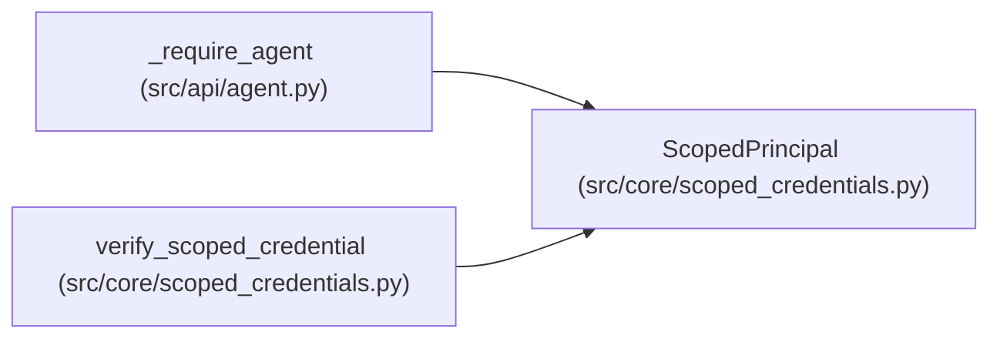

# ScopedPrincipal

**Location:** `src/core/scoped_credentials.py:51`
**Kind:** Class
**Bases:** —
**Module:** [scoped_credentials](../modules/scoped_credentials.md)

**Decorators:** `@dataclass(frozen=True)`

## Description

The verified attached-agent identity behind a scoped credential.

## Attributes

| Name | Type | Default | Description |
|------|------|---------|-------------|
| `token_id` | `str` | *required* | — |
| `subject` | `str` | *required* | — |
| `run_id` | `str` | *required* | — |
| `tenant_id` | `str` | *required* | — |
| `permissions` | `frozenset[str]` | *required* | — |
| `expires_at` | `float` | *required* | — |

## Methods

*No public methods. Inherits from base classes.*

## Relationships

<!-- Auto-generated relationship summary. Do not edit by hand. -->

### Summary

| Module | Methods | Attributes |
|---|---:|---|
| [scoped_credentials](../modules/scoped_credentials.md) | 0 | `expires_at`, `permissions`, `run_id`, `subject`, `tenant_id`, `token_id` |

### References

| Reference | Kind | Source | Call sites |
|---|---|---|---:|
| `_require_agent` | type_reference | [agent](../modules/agent.md) | — |
| `verify_scoped_credential` | call | [scoped_credentials](../modules/scoped_credentials.md) | 1 |
| `verify_scoped_credential` | type_reference | [scoped_credentials](../modules/scoped_credentials.md) | — |
