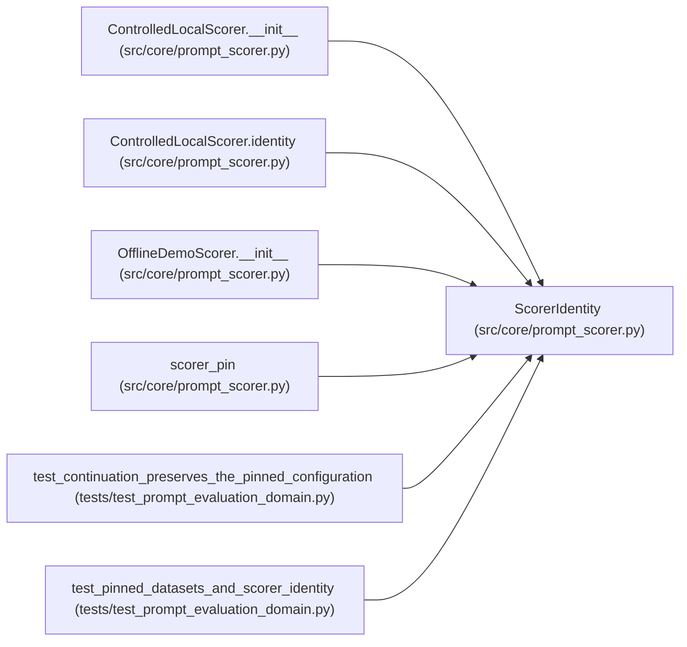

# ScorerIdentity

**Location:** `src/core/prompt_scorer.py:39`
**Kind:** Class
**Bases:** —
**Module:** [prompt_scorer](../modules/prompt_scorer.md)

**Decorators:** `@dataclass(frozen=True)`

## Description

Who scores the outputs, and at which pinned endpoint.

## Attributes

| Name | Type | Default | Description |
|------|------|---------|-------------|
| `name` | `str` | *required* | — |
| `version` | `str` | *required* | — |
| `endpoint` | `str` | *required* | — |
| `contract_version` | `str` | `SCORER_CONTRACT_VERSION` | — |

## Methods

| Method | Signature | Decorators | Description |
|--------|-----------|------------|-------------|
| `as_dict` | `() -> dict[str, Any]` | — | — |

## Relationships

<!-- Auto-generated relationship summary. Do not edit by hand. -->

### Summary

| Module | Methods | Attributes |
|---|---:|---|
| [prompt_scorer](../modules/prompt_scorer.md) | 1 | `contract_version`, `endpoint`, `name`, `version` |

### References

| Reference | Kind | Source | Call sites |
|---|---|---|---:|
| `ControlledLocalScorer.__init__` | call | [prompt_scorer](../modules/prompt_scorer.md) | 1 |
| `ControlledLocalScorer.identity` | type_reference | [prompt_scorer](../modules/prompt_scorer.md) | — |
| `OfflineDemoScorer.__init__` | call | [prompt_scorer](../modules/prompt_scorer.md) | 1 |
| `scorer_pin` | type_reference | [prompt_scorer](../modules/prompt_scorer.md) | — |
| `test_continuation_preserves_the_pinned_configuration` | call | [test_prompt_evaluation_domain](../modules/test_prompt_evaluation_domain.md) | 1 |
| `test_pinned_datasets_and_scorer_identity` | call | [test_prompt_evaluation_domain](../modules/test_prompt_evaluation_domain.md) | 1 |
