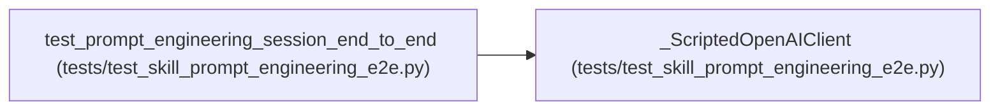

# _ScriptedOpenAIClient

**Location:** `tests/test_skill_prompt_engineering_e2e.py:288`
**Kind:** Class
**Bases:** —
**Module:** [test_skill_prompt_engineering_e2e](../modules/test_skill_prompt_engineering_e2e.md)

## Description

Stands in at the OpenAI HTTP boundary (chat.completions.create).

Content-driven (not turn-counted) so continuation kicks between turns
don't desync the script:
1. no eval output seen yet → run the eval via the bash tool;
2. eval output present, not yet relayed → relay its exact marker line
   in the SAME response that issues the next eval (the marker-relay
   contract: a marker is only honored in a turn that itself ran a
   training command — this is how real agents behave);
3. relayed, not yet forged → emit a FORGED marker (tampered nonce),
   again alongside a real eval call;
4. otherwise → TERMINATE_REQUEST + end turn.
Tool-free calls (the insights path) get plain JSON text.

## Attributes

*No annotated attributes found.*

## Methods

| Method | Signature | Decorators | Description |
|--------|-----------|------------|-------------|
| `__init__` | `(eval_command: str, session_ws: Path, nonce_is: str) -> None` | — | — |
| `_chat` | `(*, content = None, tool_calls = None, finish = 'stop')` | — | — |
| `_tool_call` | `(call_id: str, name: str, args: dict)` | `@staticmethod` | — |
| `_eval_tool_call` | `(call_id: str)` | — | — |
| `_marker_from_request` | `(kwargs: dict) -> str \| None` | — | — |
| `create` | *(async)* `(**kwargs)` | — | — |

## Relationships

<!-- Auto-generated relationship summary. Do not edit by hand. -->

### Summary

| Module | Methods | Attributes |
|---|---:|---|
| [test_skill_prompt_engineering_e2e](../modules/test_skill_prompt_engineering_e2e.md) | 6 | — |

### References

| Reference | Kind | Source | Call sites |
|---|---|---|---:|
| `test_prompt_engineering_session_end_to_end` | call | [test_skill_prompt_engineering_e2e](../modules/test_skill_prompt_engineering_e2e.md) | 1 |
