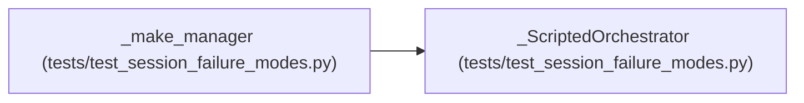

# _ScriptedOrchestrator

**Location:** `tests/test_session_failure_modes.py:459`
**Kind:** Class
**Bases:** —
**Module:** [test_session_failure_modes](../modules/test_session_failure_modes.md)

## Description

Fake orchestrator with a scripted ``run()`` outcome.

Modes:
* ``"crash"`` — raise before any iteration (the B2 shape: the raise
  happens before the orchestrator's own exception handler, exactly like
  ``materialize_skill_runtime`` in ``run()``).
* ``"complete_then_crash"`` — transition COMPLETE via the state machine,
  then raise (the orchestrator already set a terminal status; the crash
  finalizer must NOT overwrite it).
* ``"pause_then_crash"`` — transition PAUSED, then raise (a paused
  session whose task dies must still reach ``failed``).
* ``"ok"`` — capture the config and return normally.

## Attributes

*No annotated attributes found.*

## Methods

| Method | Signature | Decorators | Description |
|--------|-----------|------------|-------------|
| `__init__` | `(store: Any, mode: str) -> None` | — | — |
| `run` | *(async)* `(config: ResearchConfig) -> None` | — | — |
| `request_stop` | `(research_id: str) -> None` | — | — |
| `request_pause` | `(research_id: str) -> None` | — | — |
| `request_resume` | `(research_id: str) -> None` | — | — |

## Relationships

<!-- Auto-generated relationship summary. Do not edit by hand. -->

### Summary

| Module | Methods | Attributes |
|---|---:|---|
| [test_session_failure_modes](../modules/test_session_failure_modes.md) | 5 | — |

### References

| Reference | Kind | Source | Call sites |
|---|---|---|---:|
| `_make_manager` | call | [test_session_failure_modes](../modules/test_session_failure_modes.md) | 1 |
| `_make_manager` | type_reference | [test_session_failure_modes](../modules/test_session_failure_modes.md) | — |
