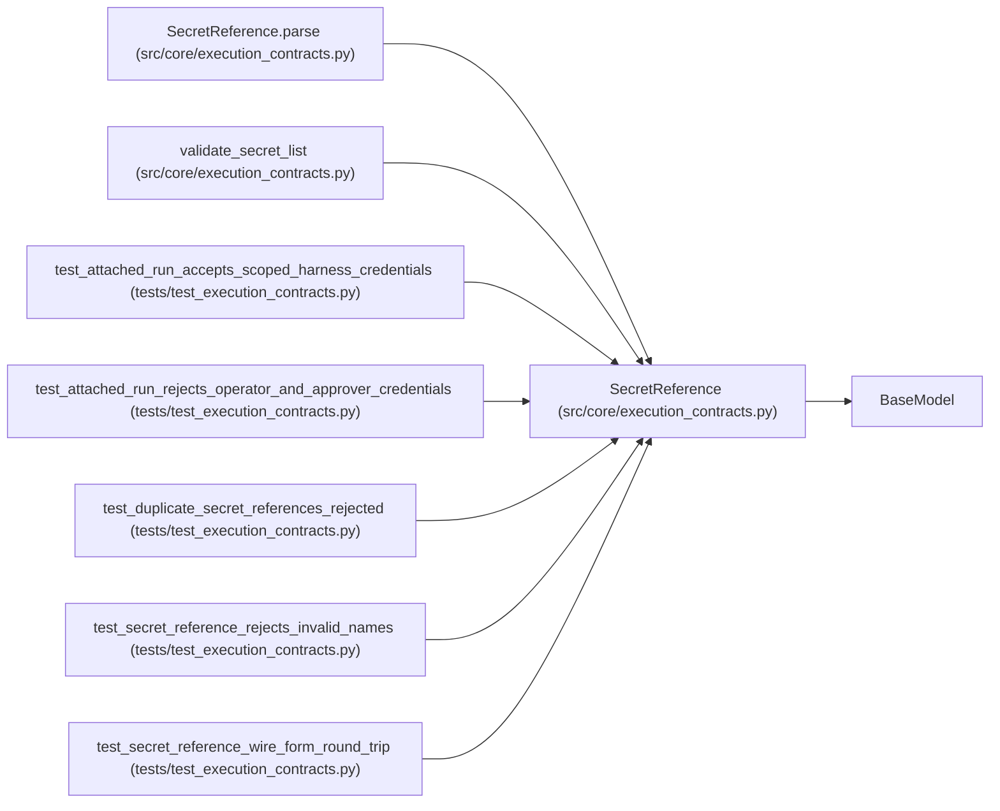

# SecretReference

**Location:** `src/core/execution_contracts.py:144`
**Kind:** Pydantic model
**Bases:** `BaseModel`
**Module:** [execution_contracts](../modules/execution_contracts.md)

## Description

A named reference to a credential; never the credential itself.

``role`` records why the credential exists and ``scope`` how narrowly it
is bound. Attached (external-agent) integrations may only reference
``harness``/``evaluator`` roles: operator bearer tokens and approver
secrets are never handed to a driver.

## Model Configuration

| Setting | Value | Source |
|---------|-------|--------|
| `extra` | `'forbid'` | model_config |

## Validators

| Method | Scope | Fields | Mode | Options |
|--------|-------|--------|------|---------|
| `_name_shape` | field | name | after | — |

## Attributes

| Name | Type | Wire name | Required | Nullable | Default | Constraints | Examples | Description |
|------|------|-----------|----------|----------|---------|-------------|-------------|----------|
| `name` | `str` | `name` | Yes | No | — | — | — | — |
| `provider` | `Literal['env', 'vault', 'operator']` | `provider` | No | No | `'env'` | — | — | — |
| `role` | `Literal['harness', 'evaluator', 'operator', 'approver']` | `role` | No | No | `'harness'` | — | — | — |
| `scope` | `Literal['run', 'attempt']` | `scope` | No | No | `'run'` | — | — | — |

## Methods

| Method | Signature | Decorators | Description |
|--------|-----------|------------|-------------|
| `_name_shape` | `(value: str) -> str` | `@field_validator('name')`, `@classmethod` | — |
| `wire_form` | `() -> str` | — | Serialize this reference for use as a parameter map value. |
| `parse` | `(value: str, **kwargs: Any) -> 'SecretReference'` | `@classmethod` | Parse the ``secret://<name>`` wire form into a reference. |

## Relationships

<!-- Auto-generated relationship summary. Do not edit by hand. -->

### Summary

| Module | Methods | Attributes |
|---|---:|---|
| [execution_contracts](../modules/execution_contracts.md) | 3 | `name`, `provider`, `role`, `scope` |

### Structure

| Kind | Entity | Module |
|---|---|---|
| Base | `BaseModel` | — |

### References

| Reference | Kind | Source | Call sites |
|---|---|---|---:|
| `SecretReference.parse` | call | [execution_contracts](../modules/execution_contracts.md) | 1 |
| `SecretReference.parse` | type_reference | [execution_contracts](../modules/execution_contracts.md) | — |
| `validate_secret_list` | type_reference | [execution_contracts](../modules/execution_contracts.md) | — |
| `test_attached_run_accepts_scoped_harness_credentials` | call | [test_execution_contracts](../modules/test_execution_contracts.md) | 1 |
| `test_attached_run_rejects_operator_and_approver_credentials` | call | [test_execution_contracts](../modules/test_execution_contracts.md) | 1 |
| `test_duplicate_secret_references_rejected` | call | [test_execution_contracts](../modules/test_execution_contracts.md) | 2 |
| `test_secret_reference_rejects_invalid_names` | call | [test_execution_contracts](../modules/test_execution_contracts.md) | 1 |
| `test_secret_reference_wire_form_round_trip` | call | [test_execution_contracts](../modules/test_execution_contracts.md) | 1 |
