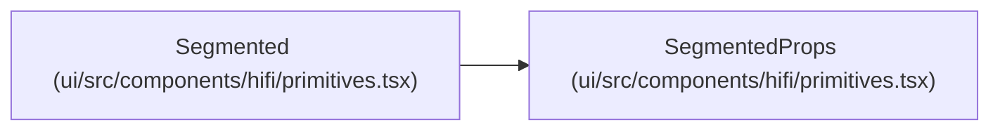

# SegmentedProps

**Location:** `ui/src/components/hifi/primitives.tsx:354`
**Kind:** Class
**Bases:** —
**Module:** [primitives](../modules/primitives.md)

## Description

_Auto-generated from `SegmentedProps` in `ui/src/components/hifi/primitives.tsx`._

## Attributes

| Name | Type | Required | Default | Description |
|------|------|----------|---------|-------------|
| `options` | `Array<string \| SegmentedOption>` | Yes | — | — |
| `value` | `string` | Yes | — | — |
| `onChange` | `(value: string) => void` | No | — | — |

## Methods

*No public methods. Inherits from base classes.*

## Relationships

<!-- Auto-generated relationship summary. Do not edit by hand. -->

### Summary

| Module | Methods | Attributes |
|---|---:|---|
| [primitives](../modules/primitives.md) | 0 | `onChange`, `options`, `value` |

### References

| Reference | Kind | Source | Call sites |
|---|---|---|---:|
| `Segmented` | type_reference | [primitives](../modules/primitives.md) | — |
