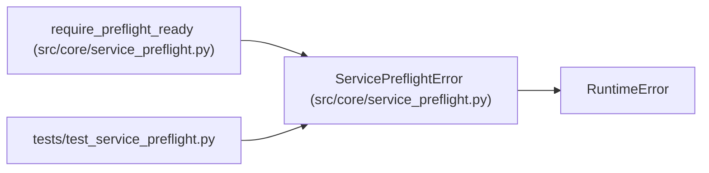

# ServicePreflightError

**Location:** `src/core/service_preflight.py:28`
**Kind:** Class
**Bases:** `RuntimeError`
**Module:** [service_preflight](../modules/service_preflight.md)

## Description

Raised when required service dependencies are not ready.

## Attributes

*No annotated attributes found.*

## Methods

| Method | Signature | Decorators | Description |
|--------|-----------|------------|-------------|
| `__init__` | `(result: dict[str, Any]) -> None` | — | — |

## Relationships

<!-- Auto-generated relationship summary. Do not edit by hand. -->

### Summary

| Module | Methods | Attributes |
|---|---:|---|
| [service_preflight](../modules/service_preflight.md) | 1 | — |

### Structure

| Kind | Entity | Module |
|---|---|---|
| Base | `RuntimeError` | — |

### References

| Reference | Kind | Source | Call sites |
|---|---|---|---:|
| `require_preflight_ready` | call | [service_preflight](../modules/service_preflight.md) | 1 |
| `test_service_preflight` | import | [test_service_preflight](../modules/test_service_preflight.md) | — |
