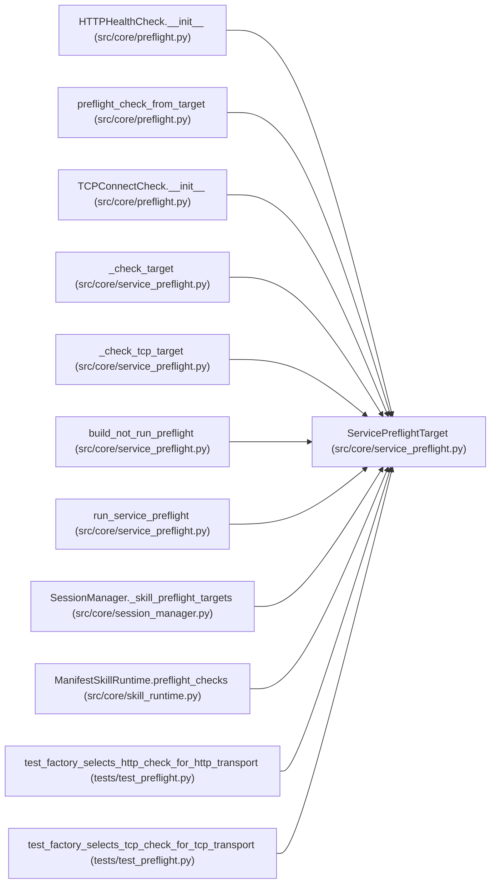

# ServicePreflightTarget

**Location:** `src/core/service_preflight.py:20`
**Kind:** Class
**Bases:** —
**Module:** [service_preflight](../modules/service_preflight.md)

**Decorators:** `@dataclass(frozen=True)`

## Description

_Auto-generated from `ServicePreflightTarget` in `src/core/service_preflight.py`._

## Attributes

| Name | Type | Default | Description |
|------|------|---------|-------------|
| `name` | `str` | *required* | — |
| `url` | `str \| None` | *required* | — |
| `health_paths` | `tuple[str, ...]` | `('/health',)` | — |
| `required` | `bool` | `True` | — |
| `transport` | `str` | `'http'` | — |

## Methods

*No public methods. Inherits from base classes.*

## Relationships

<!-- Auto-generated relationship summary. Do not edit by hand. -->

### Summary

| Module | Methods | Attributes |
|---|---:|---|
| [service_preflight](../modules/service_preflight.md) | 0 | `health_paths`, `name`, `required`, `transport`, `url` |

### References

| Reference | Kind | Source | Call sites |
|---|---|---|---:|
| `HTTPHealthCheck.__init__` | type_reference | [preflight](../modules/preflight.md) | — |
| `preflight_check_from_target` | type_reference | [preflight](../modules/preflight.md) | — |
| `TCPConnectCheck.__init__` | type_reference | [preflight](../modules/preflight.md) | — |
| `_check_target` | type_reference | [service_preflight](../modules/service_preflight.md) | — |
| `_check_tcp_target` | type_reference | [service_preflight](../modules/service_preflight.md) | — |
| `build_not_run_preflight` | type_reference | [service_preflight](../modules/service_preflight.md) | — |
| `run_service_preflight` | type_reference | [service_preflight](../modules/service_preflight.md) | — |
| `SessionManager._skill_preflight_targets` | call | [session_manager](../modules/session_manager.md) | 1 |
| `SessionManager._skill_preflight_targets` | type_reference | [session_manager](../modules/session_manager.md) | — |
| `ManifestSkillRuntime.preflight_checks` | call | [skill_runtime](../modules/skill_runtime.md) | 1 |
| `test_factory_selects_http_check_for_http_transport` | call | [test_preflight](../modules/test_preflight.md) | 1 |
| `test_factory_selects_tcp_check_for_tcp_transport` | call | [test_preflight](../modules/test_preflight.md) | 1 |

> References: showing 12 of 15 logical references; 3 omitted by the 12-row generated summary limit.
