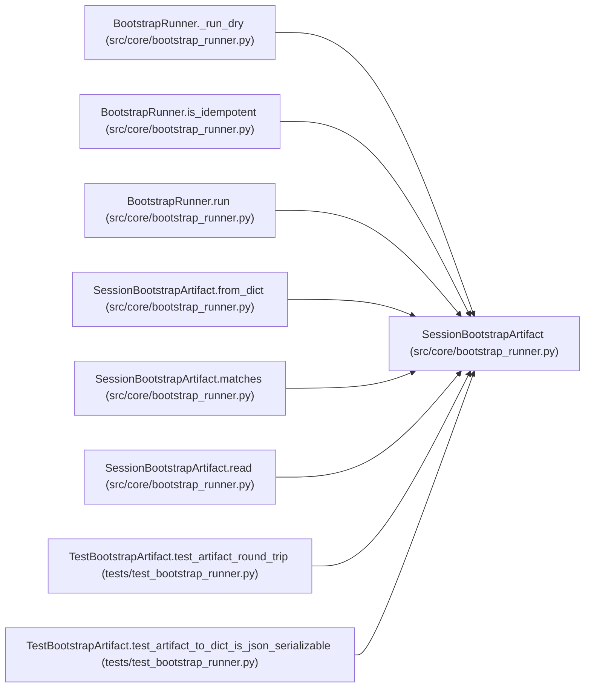

# SessionBootstrapArtifact

**Location:** `src/core/bootstrap_runner.py:89`
**Kind:** Class
**Bases:** —
**Module:** [bootstrap_runner](../modules/bootstrap_runner.md)

## Description

The ``session_bootstrap.v1`` artifact (P5-006).

A JSON sidecar recording what the bootstrap rendered: the file list with
sha256 + size, the assembled system-prompt hash, the resolved plugin caps,
the resolved tool config, and the seed search space. The orchestrator reads
this to learn the rendered workspace; reviewers read it (in dry mode) to
approve a draft.

The shape is additive-only forward-compat (``schema_version`` pins the major).

## Attributes

*No annotated attributes found.*

## Methods

| Method | Signature | Decorators | Description |
|--------|-----------|------------|-------------|
| `__init__` | `(*, schema_version: str = BOOTSTRAP_ARTIFACT_VERSION, skill_id: str, skill_version: str, workspace: str, mode: str = 'live', rendered_files: Optional[list[dict[str, Any]]] = None, system_prompt_sha256: Optional[str] = None, plugin_caps: Optional[dict[str, Any]] = None, tool_config: Optional[dict[str, Any]] = None, seed_search: Optional[dict[str, Any]] = None, plugin_output: Optional[dict[str, Any]] = None, created_at: Optional[str] = None) -> None` | — | — |
| `to_dict` | `() -> dict[str, Any]` | — | — |
| `from_dict` | `(data: dict[str, Any]) -> 'SessionBootstrapArtifact'` | `@classmethod` | — |
| `write` | `(path: Path) -> None` | — | Atomically write the artifact to ``path`` (tmp + os.replace). |
| `read` | `(path: Path) -> 'SessionBootstrapArtifact'` | `@classmethod` | — |
| `matches` | `(other: 'SessionBootstrapArtifact') -> bool` | — | True if the rendered file hashes match (idempotency check, P5-009). |
| `_files_index` | `() -> dict[str, str]` | — | — |

## Relationships

<!-- Auto-generated relationship summary. Do not edit by hand. -->

### Summary

| Module | Methods | Attributes |
|---|---:|---|
| [bootstrap_runner](../modules/bootstrap_runner.md) | 7 | — |

### References

| Reference | Kind | Source | Call sites |
|---|---|---|---:|
| `BootstrapRunner._run_dry` | call | [bootstrap_runner](../modules/bootstrap_runner.md) | 1 |
| `BootstrapRunner.is_idempotent` | type_reference | [bootstrap_runner](../modules/bootstrap_runner.md) | — |
| `BootstrapRunner.run` | call | [bootstrap_runner](../modules/bootstrap_runner.md) | 1 |
| `SessionBootstrapArtifact.from_dict` | call | [bootstrap_runner](../modules/bootstrap_runner.md) | 1 |
| `SessionBootstrapArtifact.from_dict` | type_reference | [bootstrap_runner](../modules/bootstrap_runner.md) | — |
| `SessionBootstrapArtifact.matches` | type_reference | [bootstrap_runner](../modules/bootstrap_runner.md) | — |
| `SessionBootstrapArtifact.read` | type_reference | [bootstrap_runner](../modules/bootstrap_runner.md) | — |
| `TestBootstrapArtifact.test_artifact_round_trip` | call | [test_bootstrap_runner](../modules/test_bootstrap_runner.md) | 1 |
| `TestBootstrapArtifact.test_artifact_to_dict_is_json_serializable` | call | [test_bootstrap_runner](../modules/test_bootstrap_runner.md) | 1 |
